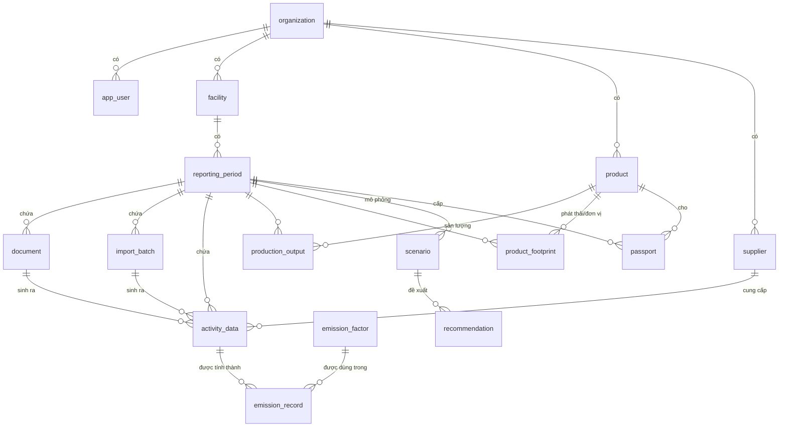

# EcoTrace Global – Tài liệu kỹ thuật Frontend & Backend

> Gộp: kiến trúc, cơ sở dữ liệu, nhập liệu, engine tính, API (backend) và các màn hình giao diện, cấu trúc frontend (frontend).
> Cập nhật: 29/10/2026

---

## Mục lục

**PHẦN I. TỔNG QUAN**

1. Giới thiệu và nguyên tắc thiết kế
2. Phạm vi chức năng
3. Kiến trúc tổng thể
4. Cấu trúc thư mục dự án (monorepo)

**PHẦN II. BACKEND**

5. Công nghệ backend và tổ chức module
6. Cơ sở dữ liệu
7. Nhập liệu và nhập file Excel
8. Engine tính phát thải
9. Mô phỏng kịch bản và đề xuất giảm phát thải
10. Hộ chiếu xanh số
11. Danh sách API
12. Bảo mật, phân quyền
13. Cấu trúc thư mục backend
14. Kiểm thử backend

**PHẦN III. FRONTEND**

15. Mục tiêu và công nghệ frontend
16. Cấu trúc thư mục frontend
17. Định tuyến và phân quyền
18. Bố cục chung
19. Các màn hình giao diện
20. Gọi API và kiểu dữ liệu
21. Quản lý trạng thái
22. Xác thực và phiên đăng nhập
23. Biểu mẫu và kiểm tra dữ liệu
24. Đa ngôn ngữ và định dạng số
25. Hệ thống giao diện (design system)
26. Trạng thái tải, rỗng, lỗi
27. Hiệu năng và khả năng truy cập
28. Kiểm thử frontend
29. Build và triển khai frontend
30. Quy ước code frontend

**PHẦN IV. TRIỂN KHAI**

31. Kế hoạch xây dựng theo sprint
32. Bản demo nhanh 7 ngày
33. Hạ tầng và chi phí vận hành
34. Biến môi trường và dữ liệu hệ số

**PHỤ LỤC**

A. SQL tạo bảng (Flyway V1–V5)

---

# PHẦN I. TỔNG QUAN

## 1. Giới thiệu và nguyên tắc thiết kế

Tài liệu gộp phần **Backend** và **Frontend** của hệ thống EcoTrace Global: nền tảng nhập liệu từ chứng từ và file Excel, tính phát thải khí nhà kính, phân bổ về sản phẩm (phục vụ CBAM), đề xuất giảm phát thải và cấp hộ chiếu xanh số cho doanh nghiệp vừa và nhỏ xuất khẩu.

**Nguyên tắc thiết kế:**

- **Mọi con số tính bằng code xác định.** Người dùng nhập số liệu từ chứng từ; hệ thống tính phát thải từ hệ số có nguồn gốc rõ ràng, để kết quả kiểm toán được.
- **Chứng từ là bằng chứng.** Mỗi dòng dữ liệu nên gắn với chứng từ gốc (hóa đơn, vận đơn) để người mua hoặc đơn vị thẩm định đối chiếu.
- **Nhập nhanh, kiểm tra chặt.** Form nhập đặt cạnh file gốc, có quy tắc kiểm tra tự động (tổng không khớp, giá trị bất thường, trùng kỳ); nhập hàng loạt bằng file Excel mẫu.
- **Truy vết được.** Mỗi con số trong báo cáo đều bấm vào được để xem nó đến từ chứng từ nào, hệ số nào, phiên bản phương pháp nào.
- **Thuần phần mềm.** Không dùng IoT hay thiết bị đo; dữ liệu lấy từ chứng từ sẵn có của doanh nghiệp.

---

## 2. Phạm vi chức năng

### 2.1. MVP (bản dùng được đầu tiên, khoảng 12 tuần)

| Module | Có trong MVP | Ghi chú |
|---|---|---|
| Đăng ký, tổ chức, nhà máy, người dùng | ✅ | Đa doanh nghiệp (multi-tenant) |
| Tải chứng từ (PDF, ảnh, Excel) | ✅ | |
| Nhập liệu từ chứng từ (form đặt cạnh file gốc): hóa đơn điện, nhiên liệu, nguyên liệu, vận đơn | ✅ | 4 loại chứng từ |
| Nhập hàng loạt bằng file Excel mẫu, kiểm tra trước khi ghi | ✅ | 5 mẫu |
| Quy tắc kiểm tra dữ liệu tự động | ✅ | Bắt buộc |
| Kho hệ số phát thải có phiên bản | ✅ | Nạp từ CSV |
| Tính Scope 1, Scope 2, Scope 3 (nguyên liệu mua vào, vận chuyển) | ✅ | |
| Phân bổ phát thải về sản phẩm (dấu chân carbon trên mỗi tấn sản phẩm) | ✅ | Cốt lõi cho CBAM |
| Dashboard tổng quan | ✅ | |
| Xuất báo cáo PDF và Excel theo mẫu dữ liệu CBAM | ✅ | |
| Hộ chiếu xanh (PDF có chữ ký số + QR + trang kiểm tra công khai) | ✅ | |
| Đề xuất giảm phát thải theo bộ quy tắc + mô phỏng kịch bản | ✅ | 5 loại kịch bản |
| Thu thập dữ liệu từ nhà cung cấp cấp dưới | ❌ | Phiên bản 2 |
| Green Marketplace | ❌ | Phiên bản 3 |
| Tích hợp IoT, phần mềm ERP | ❌ | Phiên bản 3 |

### 2.2. Phiên bản 2 (tháng 4–9)

- Cổng nhà cung cấp: gửi link cho nhà cung cấp thép, hóa chất điền dữ liệu phát thải của họ, thay cho hệ số mặc định.
- Thêm kịch bản mô phỏng: tối ưu tuyến logistics, định mức nguyên vật liệu.
- Mẫu báo cáo cho dệt may (Higg FEM, yêu cầu của nhãn hàng), mẫu kiểm kê trong nước.
- Kết nối hóa đơn điện tử Việt Nam để tự động lấy hóa đơn đầu vào.
- Đa ngôn ngữ (Việt, Anh, sau đó Indonesia, Thái).

### 2.3. Phiên bản 3 (sau tháng 9)

- Green Marketplace: hồ sơ nhà cung cấp xanh có xác thực, người mua tìm kiếm, kết nối tài chính xanh.
- API cho người mua quốc tế lấy dữ liệu trực tiếp.
- Tích hợp ERP (MISA, SAP Business One, Odoo), đồng hồ điện thông minh.
- Module EUDR cho nông sản.

---

## 3. Kiến trúc tổng thể

### 3.1. Sơ đồ tổng thể

```
                      ┌─────────────────────────────┐
                      │   Frontend (React + Vite)   │
                      │ Dashboard · Nhập liệu · BC  │
                      └──────────────┬──────────────┘
                                     │ HTTPS / REST (JWT)
                      ┌──────────────▼──────────────┐
                      │   Backend API (Spring Boot)  │
                      │  ┌────────┐  ┌────────────┐ │
                      │  │ Auth   │  │ Document   │ │
                      │  ├────────┤  ├────────────┤ │
                      │  │ Org /  │  │ Import     │ │
                      │  │Facility│  │ (Excel)    │ │
                      │  ├────────┤  ├────────────┤ │
                      │  │Activity│  │Calculation │ │
                      │  ├────────┤  ├────────────┤ │
                      │  │Report  │  │ Optimizer  │ │
                      │  ├────────┤  │ (quy tắc)  │ │
                      │  │Passport│  └────────────┘ │
                      │  └────────┘                 │
                      └──┬────────────┬─────────────┘
                         │            │
              ┌──────────▼───┐  ┌─────▼──────────────┐
              │ PostgreSQL   │  │ Object storage      │
              │ (+ Flyway)   │  │ (MinIO / S3 / GCS)  │
              └──────────────┘  └────────────────────┘
```

### 3.2. Lựa chọn công nghệ

| Lớp | Công nghệ | Lý do |
|---|---|---|
| Backend | **Java 21, Spring Boot 3.x** (Web, Security, Data JPA, Validation, Actuator) | Đội đã chọn; ổn định, dễ tuyển người |
| Cơ sở dữ liệu | **PostgreSQL 16** + **Flyway** | Quan hệ chặt, JSONB cho metadata và lỗi nhập file |
| Lưu file | **MinIO** khi phát triển, **S3/GCS** khi chạy thật | API tương thích S3 |
| Đọc file Excel nhập liệu | **Apache POI** | Đọc mẫu `.xlsx`, kiểm tra từng dòng |
| Xuất báo cáo | **OpenHTMLtoPDF** (HTML → PDF), **Apache POI** (Excel) | |
| Chữ ký số | Java `Signature` (ECDSA P-256) + **ZXing** cho QR | |
| Frontend | **React 18 + TypeScript + Vite**, **TanStack Query**, **React Router**, **Tailwind CSS**, **Recharts**, **react-i18next** | |
| Xác thực | JWT (access + refresh), mật khẩu băm BCrypt | MVP. Sau có thể chuyển Keycloak |
| Tài liệu API | **springdoc-openapi** (Swagger UI) | Frontend sinh client từ OpenAPI |
| Hạ tầng | Docker Compose (dev), một VM hoặc Cloud Run (prod), GitHub Actions (CI/CD) | Rẻ cho giai đoạn đầu |

### 3.3. Cách tổ chức backend: modular monolith

Không làm microservices ở giai đoạn đầu. Backend là **một ứng dụng Spring Boot chia module theo nghiệp vụ** (package by feature). Mỗi module có `controller / service / repository / domain / dto` riêng và chỉ gọi module khác qua service công khai. Khi cần tách (ví dụ module AI tốn tài nguyên), có thể tách ra mà ít phải sửa.

### 3.4. Luồng xử lý chính (end-to-end)

```
1. Người dùng tạo Tổ chức → Nhà máy → Kỳ báo cáo (ví dụ Q3/2026)
2a. Tải chứng từ lên ──► lưu file vào object storage, document (status=PENDING_ENTRY)
    ──► mở màn hình nhập liệu: file gốc bên trái, form bên phải ──► Lưu
    ──► kiểm tra quy tắc ──► activity_data (gắn source_document_id) ──► document (status=ENTERED)
2b. Hoặc tải file Excel mẫu ──► kiểm tra từng dòng ──► xem trước lỗi (import_batch=VALIDATED)
    ──► xác nhận ──► ghi activity_data (gắn import_batch_id) ──► import_batch (status=COMMITTED)
3. Engine tính toán  ──► activity × hệ số phát thải ──► emission_record (Scope 1/2/3)
4. Nhập sản lượng   ──► phân bổ về sản phẩm ──► product_footprint (tCO2e / tấn sản phẩm)
5. Dashboard + Báo cáo PDF/Excel
6. Bộ quy tắc đề xuất ──► mô phỏng kịch bản bằng engine ──► recommendation
7. Khóa kỳ báo cáo  ──► cấp Hộ chiếu xanh (ký số + QR + trang kiểm tra công khai)
```

---

## 4. Cấu trúc thư mục dự án (monorepo)

```
ecotrace-global/
├── README.md
├── docker-compose.yml        # PostgreSQL, MinIO, backend, frontend
├── .env.example
├── Makefile
├── .github/workflows/        # backend-ci.yml, frontend-ci.yml
├── docs/                     # Kiến trúc, mô hình dữ liệu, phương pháp tính, ADR
├── backend/                  # Spring Boot (chi tiết ở mục Backend)
├── frontend/                 # React + Vite (chi tiết ở mục Frontend)
├── data/                     # Hệ số phát thải CSV, file Excel mẫu, chứng từ mẫu
├── scripts/                  # seed_demo_data.sh, generate_signing_key.sh
└── infra/                    # nginx, cấu hình deploy
```

---

# PHẦN II. BACKEND

## 5. Công nghệ backend và tổ chức module

| Hạng mục | Lựa chọn |
|---|---|
| Ngôn ngữ, framework | Java 21, Spring Boot 3.x (Web, Security, Data JPA, Validation, Actuator) |
| Cơ sở dữ liệu | PostgreSQL 16, migration bằng Flyway, JSONB cho metadata và lỗi nhập file |
| Lưu file | MinIO (dev), S3 / GCS (prod) |
| Đọc / ghi Excel | Apache POI (nhập file mẫu, file lỗi, báo cáo CBAM) |
| Báo cáo | OpenHTMLtoPDF, ZXing (QR) |
| Xác thực | JWT (access + refresh), BCrypt |
| Tài liệu API | springdoc-openapi (`/swagger-ui.html`) |

**Các module nghiệp vụ (package by feature):**

| Module | Trách nhiệm | Bảng chính |
|---|---|---|
| `auth` | Đăng ký, đăng nhập, JWT | `app_user` |
| `organization` | Doanh nghiệp, người dùng, nhà máy, kỳ báo cáo | `organization`, `facility`, `reporting_period` |
| `document` | Tải lên, lưu file, chống trùng | `document` |
| `entry` | Nhập liệu từ chứng từ, chuyển thành dữ liệu hoạt động | `activity_data` |
| `importer` | File Excel mẫu, đọc, kiểm tra, xem trước, ghi, hủy lô | `import_batch` |
| `validation` | Quy tắc kiểm tra dùng chung cho form và Excel | — |
| `activity` | Dữ liệu hoạt động đã chuẩn hóa | `activity_data`, `supplier` |
| `emissionfactor` | Kho hệ số, nạp CSV, chọn hệ số theo năm và vùng | `emission_factor` |
| `calculation` | Engine tính Scope 1/2/3, tổng hợp | `emission_record` |
| `product` | Sản phẩm, sản lượng, phân bổ phát thải | `product`, `production_output`, `product_footprint` |
| `report` | Xuất PDF, Excel | — |
| `optimizer` | Mô phỏng kịch bản, bộ quy tắc đề xuất | `scenario`, `recommendation` |
| `passport` | Ký số, QR, trang kiểm tra công khai | `passport` |
| `common` | Tenant, audit, lỗi, chuyển đổi đơn vị | `audit_log` |

---

## 6. Cơ sở dữ liệu

### 6.1. Sơ đồ quan hệ (ERD)



Dạng chữ (nếu trình xem không hiển thị Mermaid):

```
organization 1─n app_user
organization 1─n facility 1─n reporting_period 1─n document 1─n activity_data
                                     │
                                     ├─1─n import_batch 1─n activity_data
                                     ├─1─n activity_data 1─n emission_record n─1 emission_factor
                                     ├─1─n production_output n─1 product
                                     ├─1─n product_footprint n─1 product
                                     ├─1─n scenario 1─n recommendation
                                     └─1─n passport n─1 product
organization 1─n supplier 1─n activity_data
```

### 6.2. Danh sách bảng

| Nhóm | Bảng | Mô tả |
|---|---|---|
| Nhóm lõi: doanh nghiệp, người dùng, kỳ báo cáo | `organization` | Doanh nghiệp khách hàng (tenant). |
|  | `app_user` | Người dùng thuộc một doanh nghiệp. |
|  | `facility` | Nhà máy, chi nhánh của doanh nghiệp. |
|  | `reporting_period` | Kỳ báo cáo (quý, năm) của một nhà máy. |
|  | `audit_log` | Nhật ký mọi thao tác quan trọng. |
| Nhóm chứng từ và nhập liệu | `document` | Chứng từ người dùng tải lên làm bằng chứng và nhập liệu. |
|  | `import_batch` | Một lần nhập file Excel mẫu (kết quả kiểm tra và trạng thái ghi). |
| Nhóm hoạt động và phát thải | `emission_factor` | Kho hệ số phát thải có phiên bản và nguồn. |
|  | `supplier` | Nhà cung cấp nguyên liệu. |
|  | `activity_data` | Dữ liệu hoạt động đã chuẩn hóa đơn vị, đầu vào của engine tính. |
|  | `emission_record` | Kết quả tính phát thải cho từng dòng hoạt động. |
| Nhóm sản phẩm | `product` | Sản phẩm, mã hàng của doanh nghiệp. |
|  | `production_output` | Sản lượng từng sản phẩm trong kỳ. |
|  | `product_footprint` | Phát thải trên mỗi đơn vị sản phẩm trong kỳ (phát thải nhúng CBAM). |
| Nhóm tối ưu và hộ chiếu | `scenario` | Kịch bản giảm phát thải đã mô phỏng. |
|  | `recommendation` | Đề xuất giảm phát thải do bộ quy tắc sinh ra. |
|  | `passport` | Hộ chiếu xanh số đã cấp. |

### 6.3. Chi tiết từng bảng

#### Nhóm lõi: doanh nghiệp, người dùng, kỳ báo cáo

**`organization`** — Doanh nghiệp khách hàng (tenant).

| Cột | Kiểu | Ràng buộc | Mô tả |
|---|---|---|---|
| `id` | UUID | PK, NOT NULL, mặc định `gen_random_uuid()` | Khóa chính |
| `name` | VARCHAR(255) | NOT NULL | Tên |
| `tax_code` | VARCHAR(32) |  | Mã số thuế |
| `country` | CHAR(2) | NOT NULL, mặc định `'VN'` | Mã quốc gia ISO 3166-1 alpha-2 |
| `plan` | VARCHAR(32) | NOT NULL, mặc định `'TRIAL'` | Gói dịch vụ: TRIAL, STARTER, GROWTH |
| `created_at` | TIMESTAMPTZ | NOT NULL, mặc định `now()` | Thời điểm tạo |
| `updated_at` | TIMESTAMPTZ | NOT NULL, mặc định `now()` | Thời điểm cập nhật gần nhất |

**`app_user`** — Người dùng thuộc một doanh nghiệp.

| Cột | Kiểu | Ràng buộc | Mô tả |
|---|---|---|---|
| `id` | UUID | PK, NOT NULL, mặc định `gen_random_uuid()` | Khóa chính |
| `organization_id` | UUID | NOT NULL, FK → organization.id | Doanh nghiệp sở hữu (tenant), dùng để cách ly dữ liệu |
| `email` | VARCHAR(255) | NOT NULL, UNIQUE | Email đăng nhập (duy nhất) |
| `password_hash` | VARCHAR(100) | NOT NULL | Mật khẩu đã băm BCrypt |
| `full_name` | VARCHAR(255) |  | Họ tên |
| `role` | VARCHAR(32) | NOT NULL, ∈ {OWNER, EDITOR, VIEWER, SYSTEM_ADMIN} | Vai trò: OWNER, EDITOR, VIEWER, SYSTEM_ADMIN |
| `active` | BOOLEAN | NOT NULL, mặc định `TRUE` | Tài khoản còn hoạt động |
| `created_at` | TIMESTAMPTZ | NOT NULL, mặc định `now()` | Thời điểm tạo |
| `updated_at` | TIMESTAMPTZ | NOT NULL, mặc định `now()` | Thời điểm cập nhật gần nhất |

Index: `idx_user_org(organization_id)`

**`facility`** — Nhà máy, chi nhánh của doanh nghiệp.

| Cột | Kiểu | Ràng buộc | Mô tả |
|---|---|---|---|
| `id` | UUID | PK, NOT NULL, mặc định `gen_random_uuid()` | Khóa chính |
| `organization_id` | UUID | NOT NULL, FK → organization.id | Doanh nghiệp sở hữu (tenant), dùng để cách ly dữ liệu |
| `name` | VARCHAR(255) | NOT NULL | Tên |
| `address` | TEXT |  | Địa chỉ nhà máy |
| `country` | CHAR(2) | NOT NULL, mặc định `'VN'` | Mã quốc gia ISO 3166-1 alpha-2 |
| `grid_region` | VARCHAR(32) | NOT NULL, mặc định `'VN'` | Vùng lưới điện, dùng chọn hệ số điện |
| `created_at` | TIMESTAMPTZ | NOT NULL, mặc định `now()` | Thời điểm tạo |
| `updated_at` | TIMESTAMPTZ | NOT NULL, mặc định `now()` | Thời điểm cập nhật gần nhất |

Index: `idx_facility_org(organization_id)`

**`reporting_period`** — Kỳ báo cáo (quý, năm) của một nhà máy.

| Cột | Kiểu | Ràng buộc | Mô tả |
|---|---|---|---|
| `id` | UUID | PK, NOT NULL, mặc định `gen_random_uuid()` | Khóa chính |
| `organization_id` | UUID | NOT NULL, FK → organization.id | Doanh nghiệp sở hữu (tenant), dùng để cách ly dữ liệu |
| `facility_id` | UUID | NOT NULL, FK → facility.id | Nhà máy |
| `name` | VARCHAR(64) | NOT NULL | Tên |
| `start_date` | DATE | NOT NULL | Ngày bắt đầu kỳ |
| `end_date` | DATE | NOT NULL | Ngày kết thúc kỳ |
| `status` | VARCHAR(16) | NOT NULL, mặc định `'OPEN'`, ∈ {OPEN, LOCKED} | Trạng thái (xem bảng giá trị enum) |
| `locked_at` | TIMESTAMPTZ |  | Thời điểm khóa kỳ |
| `locked_by` | UUID | FK → app_user.id | Người khóa kỳ |
| `created_at` | TIMESTAMPTZ | NOT NULL, mặc định `now()` | Thời điểm tạo |
| `updated_at` | TIMESTAMPTZ | NOT NULL, mặc định `now()` | Thời điểm cập nhật gần nhất |

Ràng buộc bảng: `CHECK (end_date >= start_date)`

Index: `idx_period_org(organization_id)`

**`audit_log`** — Nhật ký mọi thao tác quan trọng.

| Cột | Kiểu | Ràng buộc | Mô tả |
|---|---|---|---|
| `id` | BIGSERIAL | PK, NOT NULL | Khóa chính |
| `organization_id` | UUID |  | Doanh nghiệp sở hữu (tenant), dùng để cách ly dữ liệu |
| `user_id` | UUID |  | Người thực hiện |
| `action` | VARCHAR(64) | NOT NULL | Hành động: CREATE, UPDATE, APPROVE, LOCK, ISSUE_PASSPORT… |
| `entity` | VARCHAR(64) | NOT NULL | Tên bảng / đối tượng bị tác động |
| `entity_id` | VARCHAR(64) |  | ID đối tượng bị tác động |
| `before_data` | JSONB |  | Dữ liệu trước khi thay đổi |
| `after_data` | JSONB |  | Dữ liệu sau khi thay đổi |
| `created_at` | TIMESTAMPTZ | NOT NULL, mặc định `now()` | Thời điểm tạo |

Index: `idx_audit_org_time(organization_id, created_at DESC)`

#### Nhóm chứng từ và nhập liệu

**`document`** — Chứng từ người dùng tải lên làm bằng chứng và nhập liệu.

| Cột | Kiểu | Ràng buộc | Mô tả |
|---|---|---|---|
| `id` | UUID | PK, NOT NULL, mặc định `gen_random_uuid()` | Khóa chính |
| `organization_id` | UUID | NOT NULL, FK → organization.id | Doanh nghiệp sở hữu (tenant), dùng để cách ly dữ liệu |
| `facility_id` | UUID | NOT NULL, FK → facility.id | Nhà máy |
| `period_id` | UUID | NOT NULL, FK → reporting_period.id | Kỳ báo cáo |
| `doc_type` | VARCHAR(32) | NOT NULL, ∈ {ELECTRICITY_BILL, FUEL_INVOICE, MATERIAL_INVOICE, BILL_OF_LADING, OTHER} | Loại chứng từ |
| `storage_key` | VARCHAR(512) | NOT NULL | Đường dẫn file trong object storage |
| `file_name` | VARCHAR(255) | NOT NULL | Tên file gốc |
| `mime_type` | VARCHAR(100) | NOT NULL | Kiểu file (application/pdf, image/jpeg…) |
| `size_bytes` | BIGINT | NOT NULL | Dung lượng file |
| `sha256` | CHAR(64) | NOT NULL | Mã băm file, chống tải trùng |
| `status` | VARCHAR(16) | NOT NULL, mặc định `'PENDING_ENTRY'`, ∈ {PENDING_ENTRY, ENTERED, REJECTED} | Trạng thái (xem bảng giá trị enum) |
| `reject_reason` | VARCHAR(255) |  | Lý do đánh dấu không dùng |
| `uploaded_by` | UUID | FK → app_user.id | Người tải lên |
| `entered_by` | UUID | FK → app_user.id | Người nhập liệu |
| `entered_at` | TIMESTAMPTZ |  | Thời điểm nhập liệu xong |
| `created_at` | TIMESTAMPTZ | NOT NULL, mặc định `now()` | Thời điểm tạo |
| `updated_at` | TIMESTAMPTZ | NOT NULL, mặc định `now()` | Thời điểm cập nhật gần nhất |

Ràng buộc bảng: `UNIQUE (organization_id, sha256)`

Index: `idx_document_period(period_id, status)`

**`import_batch`** — Một lần nhập file Excel mẫu (kết quả kiểm tra và trạng thái ghi).

| Cột | Kiểu | Ràng buộc | Mô tả |
|---|---|---|---|
| `id` | UUID | PK, NOT NULL, mặc định `gen_random_uuid()` | Khóa chính |
| `organization_id` | UUID | NOT NULL, FK → organization.id | Doanh nghiệp sở hữu (tenant), dùng để cách ly dữ liệu |
| `period_id` | UUID | NOT NULL, FK → reporting_period.id | Kỳ báo cáo |
| `template_type` | VARCHAR(32) | NOT NULL, ∈ {ELECTRICITY, FUEL, MATERIAL, TRANSPORT, PRODUCTION} | Mẫu Excel: ELECTRICITY, FUEL, MATERIAL, TRANSPORT, PRODUCTION |
| `file_name` | VARCHAR(255) | NOT NULL | Tên file gốc |
| `storage_key` | VARCHAR(512) | NOT NULL | Đường dẫn file trong object storage |
| `total_rows` | INT | NOT NULL, mặc định `0` | Tổng số dòng trong file |
| `valid_rows` | INT | NOT NULL, mặc định `0` | Số dòng hợp lệ |
| `error_rows` | INT | NOT NULL, mặc định `0` | Số dòng lỗi |
| `errors` | JSONB | NOT NULL, mặc định `'[]'::jsonb` | Danh sách lỗi [{row, column, value, message}] |
| `status` | VARCHAR(16) | NOT NULL, mặc định `'VALIDATED'`, ∈ {VALIDATED, COMMITTED, CANCELLED} | Trạng thái (xem bảng giá trị enum) |
| `created_by` | UUID | FK → app_user.id | Người tạo |
| `committed_at` | TIMESTAMPTZ |  | Thời điểm ghi dữ liệu |
| `created_at` | TIMESTAMPTZ | NOT NULL, mặc định `now()` | Thời điểm tạo |

Index: `idx_import_period(period_id)`

#### Nhóm hoạt động và phát thải

**`emission_factor`** — Kho hệ số phát thải có phiên bản và nguồn.

| Cột | Kiểu | Ràng buộc | Mô tả |
|---|---|---|---|
| `id` | UUID | PK, NOT NULL, mặc định `gen_random_uuid()` | Khóa chính |
| `code` | VARCHAR(64) | NOT NULL | Mã định danh hệ số |
| `category` | VARCHAR(32) | NOT NULL | Hạng mục hoạt động (xem bảng enum) |
| `sub_category` | VARCHAR(64) |  | Loại con (DIESEL, GRID, STEEL…) |
| `region` | VARCHAR(16) | NOT NULL, mặc định `'GLOBAL'` | Khu vực áp dụng (VN, GLOBAL…) |
| `value` | NUMERIC(18,8) | NOT NULL | Giá trị hệ số |
| `unit_numerator` | VARCHAR(16) | NOT NULL | Đơn vị tử số (kgCO2e) |
| `unit_denominator` | VARCHAR(16) | NOT NULL | Đơn vị mẫu số (kWh, litre, kg, tkm) |
| `gas` | VARCHAR(16) | NOT NULL, mặc định `'CO2e'` | Loại khí (CO2, CO2e) |
| `source` | TEXT | NOT NULL | Nguồn công bố hệ số |
| `source_year` | INT | NOT NULL | Năm của nguồn |
| `valid_from` | DATE | NOT NULL | Áp dụng từ ngày |
| `valid_to` | DATE |  | Áp dụng đến ngày (NULL = còn hiệu lực) |
| `version` | INT | NOT NULL, mặc định `1` | Phiên bản |
| `created_at` | TIMESTAMPTZ | NOT NULL, mặc định `now()` | Thời điểm tạo |

Ràng buộc bảng: `UNIQUE (code, version)`

Index: `idx_ef_lookup(category, sub_category, region, valid_from)`

**`supplier`** — Nhà cung cấp nguyên liệu.

| Cột | Kiểu | Ràng buộc | Mô tả |
|---|---|---|---|
| `id` | UUID | PK, NOT NULL, mặc định `gen_random_uuid()` | Khóa chính |
| `organization_id` | UUID | NOT NULL, FK → organization.id | Doanh nghiệp sở hữu (tenant), dùng để cách ly dữ liệu |
| `name` | VARCHAR(255) | NOT NULL | Tên |
| `country` | CHAR(2) |  | Mã quốc gia ISO 3166-1 alpha-2 |
| `material` | VARCHAR(128) |  | Nguyên liệu cung cấp |
| `created_at` | TIMESTAMPTZ | NOT NULL, mặc định `now()` | Thời điểm tạo |

**`activity_data`** — Dữ liệu hoạt động đã chuẩn hóa đơn vị, đầu vào của engine tính.

| Cột | Kiểu | Ràng buộc | Mô tả |
|---|---|---|---|
| `id` | UUID | PK, NOT NULL, mặc định `gen_random_uuid()` | Khóa chính |
| `organization_id` | UUID | NOT NULL, FK → organization.id | Doanh nghiệp sở hữu (tenant), dùng để cách ly dữ liệu |
| `period_id` | UUID | NOT NULL, FK → reporting_period.id | Kỳ báo cáo |
| `facility_id` | UUID | NOT NULL, FK → facility.id | Nhà máy |
| `source_document_id` | UUID | FK → document.id | Chứng từ sinh ra dòng này (NULL nếu nhập tay) |
| `import_batch_id` | UUID | FK → import_batch.id, xóa theo cha | Lô nhập Excel sinh ra dòng này |
| `entry_method` | VARCHAR(16) | NOT NULL, ∈ {DOCUMENT, IMPORT, MANUAL} | Cách nhập: DOCUMENT, IMPORT, MANUAL |
| `created_by` | UUID | FK → app_user.id | Người tạo |
| `category` | VARCHAR(32) | NOT NULL | Hạng mục hoạt động (xem bảng enum) |
| `sub_category` | VARCHAR(64) |  | Loại con (DIESEL, GRID, STEEL…) |
| `quantity` | NUMERIC(18,6) | NOT NULL, CHECK `quantity >= 0` | Số lượng |
| `unit` | VARCHAR(16) | NOT NULL | Đơn vị |
| `activity_date` | DATE | NOT NULL | Ngày phát sinh hoạt động |
| `supplier_id` | UUID | FK → supplier.id | Nhà cung cấp |
| `metadata` | JSONB | NOT NULL, mặc định `'{}'::jsonb` | Thông tin bổ sung (cảng đi/đến, khoảng cách…) |
| `created_at` | TIMESTAMPTZ | NOT NULL, mặc định `now()` | Thời điểm tạo |
| `updated_at` | TIMESTAMPTZ | NOT NULL, mặc định `now()` | Thời điểm cập nhật gần nhất |

Index: `idx_activity_period(period_id, category)`

**`emission_record`** — Kết quả tính phát thải cho từng dòng hoạt động.

| Cột | Kiểu | Ràng buộc | Mô tả |
|---|---|---|---|
| `id` | UUID | PK, NOT NULL, mặc định `gen_random_uuid()` | Khóa chính |
| `activity_data_id` | UUID | NOT NULL, FK → activity_data.id, xóa theo cha | Dữ liệu hoạt động được tính |
| `emission_factor_id` | UUID | NOT NULL, FK → emission_factor.id | Hệ số đã dùng |
| `scope` | SMALLINT | NOT NULL, CHECK `scope IN (1,2,3)` | Phạm vi phát thải 1, 2, 3 |
| `scope3_category` | SMALLINT |  | Hạng mục Scope 3 theo GHG Protocol (1–15) |
| `co2e_kg` | NUMERIC(18,6) | NOT NULL | Lượng phát thải (kg CO2e) |
| `method` | VARCHAR(32) | NOT NULL | Phương pháp (LOCATION_BASED, ACTIVITY_BASED…) |
| `calc_version` | VARCHAR(16) | NOT NULL | Phiên bản engine tính |
| `calculated_at` | TIMESTAMPTZ | NOT NULL, mặc định `now()` | Thời điểm tính |

Index: `idx_emission_activity(activity_data_id)`

#### Nhóm sản phẩm

**`product`** — Sản phẩm, mã hàng của doanh nghiệp.

| Cột | Kiểu | Ràng buộc | Mô tả |
|---|---|---|---|
| `id` | UUID | PK, NOT NULL, mặc định `gen_random_uuid()` | Khóa chính |
| `organization_id` | UUID | NOT NULL, FK → organization.id | Doanh nghiệp sở hữu (tenant), dùng để cách ly dữ liệu |
| `name` | VARCHAR(255) | NOT NULL | Tên |
| `hs_code` | VARCHAR(16) |  | Mã HS |
| `cn_code` | VARCHAR(16) |  | Mã CN (danh mục hàng hóa EU, dùng cho CBAM) |
| `unit` | VARCHAR(16) | NOT NULL, mặc định `'t'` | Đơn vị |
| `created_at` | TIMESTAMPTZ | NOT NULL, mặc định `now()` | Thời điểm tạo |

**`production_output`** — Sản lượng từng sản phẩm trong kỳ.

| Cột | Kiểu | Ràng buộc | Mô tả |
|---|---|---|---|
| `id` | UUID | PK, NOT NULL, mặc định `gen_random_uuid()` | Khóa chính |
| `period_id` | UUID | NOT NULL, FK → reporting_period.id | Kỳ báo cáo |
| `product_id` | UUID | NOT NULL, FK → product.id | Sản phẩm |
| `quantity` | NUMERIC(18,6) | NOT NULL, CHECK `quantity > 0` | Số lượng |
| `unit` | VARCHAR(16) | NOT NULL, mặc định `'t'` | Đơn vị |

Ràng buộc bảng: `UNIQUE (period_id, product_id)`

**`product_footprint`** — Phát thải trên mỗi đơn vị sản phẩm trong kỳ (phát thải nhúng CBAM).

| Cột | Kiểu | Ràng buộc | Mô tả |
|---|---|---|---|
| `id` | UUID | PK, NOT NULL, mặc định `gen_random_uuid()` | Khóa chính |
| `period_id` | UUID | NOT NULL, FK → reporting_period.id | Kỳ báo cáo |
| `product_id` | UUID | NOT NULL, FK → product.id | Sản phẩm |
| `direct_co2e_per_unit` | NUMERIC(18,6) | NOT NULL | Phát thải trực tiếp trên mỗi đơn vị sản phẩm |
| `indirect_co2e_per_unit` | NUMERIC(18,6) | NOT NULL | Phát thải gián tiếp (điện) trên mỗi đơn vị |
| `precursor_co2e_per_unit` | NUMERIC(18,6) | NOT NULL | Phát thải tiền chất trên mỗi đơn vị |
| `total_co2e_per_unit` | NUMERIC(18,6) | NOT NULL | Tổng phát thải nhúng trên mỗi đơn vị |
| `actual_data_share` | NUMERIC(5,4) |  | Tỷ lệ dữ liệu thực tế so với giá trị mặc định (0–1) |
| `allocation_method` | VARCHAR(32) | NOT NULL, mặc định `'MASS'` | Phương pháp phân bổ: MASS, MACHINE_HOURS |
| `calculated_at` | TIMESTAMPTZ | NOT NULL, mặc định `now()` | Thời điểm tính |

Ràng buộc bảng: `UNIQUE (period_id, product_id)`

#### Nhóm tối ưu và hộ chiếu

**`scenario`** — Kịch bản giảm phát thải đã mô phỏng.

| Cột | Kiểu | Ràng buộc | Mô tả |
|---|---|---|---|
| `id` | UUID | PK, NOT NULL, mặc định `gen_random_uuid()` | Khóa chính |
| `period_id` | UUID | NOT NULL, FK → reporting_period.id | Kỳ báo cáo |
| `type` | VARCHAR(32) | NOT NULL, ∈ {SOLAR_ROOFTOP, FUEL_SWITCH, SUPPLIER_SWITCH, TRANSPORT_MODE_SHIFT, ENERGY_EFFICIENCY} | Loại kịch bản |
| `parameters` | JSONB | NOT NULL | Tham số kịch bản |
| `baseline_co2e` | NUMERIC(18,6) | NOT NULL | Phát thải hiện tại (kg CO2e) |
| `projected_co2e` | NUMERIC(18,6) | NOT NULL | Phát thải dự kiến sau khi áp dụng |
| `cost_delta_usd` | NUMERIC(18,2) |  | Chênh lệch chi phí ước tính (USD) |
| `payback_years` | NUMERIC(6,2) |  | Số năm hoàn vốn |
| `created_by` | VARCHAR(8) | NOT NULL, ∈ {USER, SYSTEM} | Nguồn tạo: USER (người dùng tự mô phỏng) hoặc SYSTEM (bộ quy tắc) |
| `created_at` | TIMESTAMPTZ | NOT NULL, mặc định `now()` | Thời điểm tạo |

**`recommendation`** — Đề xuất giảm phát thải do bộ quy tắc sinh ra.

| Cột | Kiểu | Ràng buộc | Mô tả |
|---|---|---|---|
| `id` | UUID | PK, NOT NULL, mặc định `gen_random_uuid()` | Khóa chính |
| `period_id` | UUID | NOT NULL, FK → reporting_period.id | Kỳ báo cáo |
| `scenario_id` | UUID | FK → scenario.id | Kịch bản liên quan |
| `rule_code` | VARCHAR(64) | NOT NULL | Mã quy tắc sinh ra đề xuất (R_SOLAR, R_FUEL…) |
| `title` | VARCHAR(255) | NOT NULL | Tiêu đề |
| `explanation` | TEXT | NOT NULL | Giải thích cho người dùng |
| `priority` | SMALLINT | NOT NULL, mặc định `2` | Độ ưu tiên (1 cao nhất) |
| `status` | VARCHAR(16) | NOT NULL, mặc định `'NEW'`, ∈ {NEW, ACCEPTED, DISMISSED} | Trạng thái (xem bảng giá trị enum) |
| `created_at` | TIMESTAMPTZ | NOT NULL, mặc định `now()` | Thời điểm tạo |

**`passport`** — Hộ chiếu xanh số đã cấp.

| Cột | Kiểu | Ràng buộc | Mô tả |
|---|---|---|---|
| `id` | UUID | PK, NOT NULL, mặc định `gen_random_uuid()` | Khóa chính |
| `organization_id` | UUID | NOT NULL, FK → organization.id | Doanh nghiệp sở hữu (tenant), dùng để cách ly dữ liệu |
| `period_id` | UUID | NOT NULL, FK → reporting_period.id | Kỳ báo cáo |
| `product_id` | UUID | NOT NULL, FK → product.id | Sản phẩm |
| `payload` | JSONB | NOT NULL | Dữ liệu đầu vào / nội dung |
| `payload_hash` | CHAR(64) | NOT NULL | SHA-256 của payload (canonical JSON) |
| `signature` | TEXT | NOT NULL | Chữ ký ECDSA (Base64) |
| `public_code` | VARCHAR(16) | NOT NULL, UNIQUE | Mã công khai in trên QR, ví dụ ET-7KQ2-9XMA |
| `verification` | VARCHAR(16) | NOT NULL, mặc định `'SELF_DECLARED'`, ∈ {SELF_DECLARED, VERIFIED} | SELF_DECLARED hoặc VERIFIED |
| `verifier_name` | VARCHAR(255) |  | Tên đơn vị thẩm định (nếu có) |
| `issued_at` | TIMESTAMPTZ | NOT NULL, mặc định `now()` | Thời điểm cấp |
| `revoked_at` | TIMESTAMPTZ |  | Thời điểm thu hồi (NULL = còn hiệu lực) |

### 6.4. Giá trị enum

| Bảng.cột | Giá trị | Ý nghĩa |
|---|---|---|
| `app_user.role` | OWNER, EDITOR, VIEWER, SYSTEM_ADMIN | Toàn quyền doanh nghiệp / tải, nhập liệu, tính / chỉ xem / quản trị hệ thống (hệ số) |
| `reporting_period.status` | OPEN, LOCKED | Đang mở / đã khóa (không sửa được, mới cấp hộ chiếu) |
| `document.doc_type` | ELECTRICITY_BILL, FUEL_INVOICE, MATERIAL_INVOICE, BILL_OF_LADING, OTHER | Hóa đơn điện / nhiên liệu / nguyên liệu / vận đơn / khác |
| `document.status` | PENDING_ENTRY → ENTERED, hoặc REJECTED | Chưa nhập liệu / đã nhập / không dùng |
| `import_batch.template_type` | ELECTRICITY, FUEL, MATERIAL, TRANSPORT, PRODUCTION | Mẫu Excel |
| `import_batch.status` | VALIDATED → COMMITTED, hoặc CANCELLED | Đã kiểm tra (chưa ghi) / đã ghi / đã hủy |
| `activity_data.entry_method` | DOCUMENT, IMPORT, MANUAL | Nhập từ chứng từ / từ file Excel / nhập tay không chứng từ |
| `activity_data.category` | ELECTRICITY, STATIONARY_FUEL, MOBILE_FUEL, PROCESS, PURCHASED_MATERIAL, UPSTREAM_TRANSPORT, DOWNSTREAM_TRANSPORT, WASTE | Hạng mục hoạt động (ánh xạ scope ở bảng dưới) |
| `scenario.type` | SOLAR_ROOFTOP, FUEL_SWITCH, SUPPLIER_SWITCH, TRANSPORT_MODE_SHIFT, ENERGY_EFFICIENCY | Loại kịch bản |
| `scenario.created_by` | USER, SYSTEM | Người dùng tự mô phỏng / bộ quy tắc tạo |
| `recommendation.rule_code` | R_SOLAR, R_FUEL, R_SUPPLIER, R_TRANSPORT, R_EFFICIENCY, R_DATA | Quy tắc sinh đề xuất |
| `recommendation.status` | NEW, ACCEPTED, DISMISSED | |
| `passport.verification` | SELF_DECLARED, VERIFIED | Tự khai báo / đã thẩm định độc lập |

**Ánh xạ hạng mục hoạt động sang scope:**

| category | Scope | Ví dụ | Đơn vị chuẩn |
|---|---|---|---|
| `ELECTRICITY` | 2 | Điện lưới | kWh |
| `STATIONARY_FUEL` | 1 | Dầu DO cho lò, than, LPG, khí tự nhiên | lít, kg, m³ |
| `MOBILE_FUEL` | 1 | Xăng, dầu xe nâng, xe tải công ty | lít |
| `PROCESS` | 1 | Phát thải quá trình (ví dụ điện cực than trong lò hồ quang) | kg |
| `PURCHASED_MATERIAL` | 3 (cat. 1) | Thép cuộn, phôi nhôm, hóa chất, vải | kg, tấn |
| `UPSTREAM_TRANSPORT` | 3 (cat. 4) | Vận chuyển nguyên liệu về nhà máy | tấn·km |
| `DOWNSTREAM_TRANSPORT` | 3 (cat. 9) | Vận chuyển thành phẩm ra cảng | tấn·km |
| `WASTE` | 3 (cat. 5) | Chất thải xử lý | kg |

### 6.5. Quy tắc thiết kế dữ liệu

- **Khóa chính** dùng UUID (`gen_random_uuid()`), riêng `audit_log` dùng BIGSERIAL vì ghi nhiều và cần thứ tự.
- **Tiền tệ, số lượng, phát thải** dùng `NUMERIC`, không dùng số thực dấu phẩy động.
- **Thời gian** lưu `TIMESTAMPTZ` theo UTC; frontend đổi sang giờ địa phương.
- **Cách ly tenant:** mọi bảng nghiệp vụ có `organization_id` trực tiếp hoặc qua bảng cha (`period_id` → `reporting_period.organization_id`). Mọi truy vấn phải lọc theo tenant lấy từ JWT.
- **Không xóa cứng dữ liệu đã dùng để tính:** chứng từ đã nhập liệu, hệ số đã dùng trong kỳ đã khóa không được xóa; hệ số mới thêm dòng với `version` mới.
- **Migration** chỉ thêm, không sửa file migration đã chạy; mọi thay đổi schema là một file `V6__mo_ta.sql` mới (Flyway).
- **Sao lưu** hằng ngày, giữ 30 ngày; thử khôi phục định kỳ mỗi tháng.

### 6.6. Thứ tự migration (Flyway)

| File | Nội dung |
|---|---|
| `V1__init_core.sql` | organization, app_user, facility, reporting_period, audit_log |
| `V2__documents_imports.sql` | document, import_batch |
| `V3__activity_emission.sql` | emission_factor, supplier, activity_data, emission_record |
| `V4__product_footprint.sql` | product, production_output, product_footprint |
| `V5__optimizer_passport.sql` | scenario, recommendation, passport |
| `V6__seed_emission_factors.sql` | Không seed cứng; hệ số nạp từ CSV qua API admin sau khi được kiểm tra |

Toàn bộ câu lệnh SQL tạo bảng nằm ở Phụ lục A.

---

## 7. Nhập liệu và nhập file Excel

### 7.1. Hai cách đưa dữ liệu vào hệ thống

| Cách | Khi nào dùng | Kết quả |
|---|---|---|
| **Nhập liệu từ chứng từ** | Vài chục chứng từ mỗi kỳ (hóa đơn điện hằng tháng, hóa đơn dầu) | Mỗi chứng từ một form; dữ liệu gắn với file gốc làm bằng chứng |
| **Nhập file Excel mẫu** | Nhiều dòng (hàng trăm hóa đơn nguyên liệu, danh sách lô hàng xuất) hoặc dữ liệu đã có sẵn trong phần mềm kế toán | Một lần tải, kiểm tra toàn bộ, ghi hàng loạt |

Người dùng cũng có thể **nhập tay** một dòng hoạt động không có chứng từ (ví dụ số đọc công tơ tự ghi), dòng đó được gắn nhãn "Không có chứng từ".

### 7.2. Luồng nhập liệu từ chứng từ

```
Tải file ─► Kiểm tra (định dạng PDF/JPG/PNG, dung lượng ≤ 20MB, trùng sha256)
        ─► Chọn loại chứng từ ─► document (PENDING_ENTRY)
        ─► Màn hình nhập liệu: xem file gốc + form theo loại chứng từ
        ─► Lưu ─► kiểm tra quy tắc (mục 7.4)
               ├─ Lỗi chặn  → báo lỗi tại trường, không lưu
               └─ Cảnh báo  → người dùng xác nhận "Vẫn lưu"
        ─► Chuẩn hóa đơn vị ─► activity_data ─► tính phát thải ─► document (ENTERED)
```

**Trường nhập cho từng loại chứng từ:**

| Loại | Trường bắt buộc | Trường tùy chọn | Sinh ra activity_data |
|---|---|---|---|
| Hóa đơn điện | Kỳ hóa đơn (từ ngày – đến ngày), tổng kWh | Mã khách hàng, số công tơ, kWh theo khung giờ, số tiền | 1 dòng `ELECTRICITY` |
| Hóa đơn nhiên liệu | Ngày, các dòng: loại nhiên liệu, số lượng, đơn vị, mục đích (lò/thiết bị cố định hoặc xe) | Người bán, số hóa đơn, số tiền | Mỗi dòng 1 `STATIONARY_FUEL` hoặc `MOBILE_FUEL` |
| Hóa đơn nguyên liệu | Ngày, các dòng: nhóm vật liệu, số lượng, đơn vị | Nhà cung cấp, xuất xứ, mã hàng | Mỗi dòng 1 `PURCHASED_MATERIAL` |
| Vận đơn | Phương thức, nơi đi, nơi đến, khối lượng | Số vận đơn, số container, khoảng cách (nếu không có thì tra bảng tuyến) | 1 dòng `UPSTREAM_TRANSPORT` hoặc `DOWNSTREAM_TRANSPORT` |

### 7.3. Nhập file Excel mẫu

**Các mẫu (tải về từ hệ thống, có sẵn hướng dẫn và danh sách chọn):**

| Mẫu | Cột |
|---|---|
| `ELECTRICITY` | from_date, to_date, kwh, meter_code, note |
| `FUEL` | date, fuel_type, usage (STATIONARY/MOBILE), quantity, unit, supplier, invoice_no |
| `MATERIAL` | date, material_group, description, quantity, unit, supplier, origin_country, invoice_no |
| `TRANSPORT` | date, direction (INBOUND/OUTBOUND), mode, origin, destination, weight_kg, distance_km |
| `PRODUCTION` | product_code, quantity, unit |

**Luồng hai bước:**

```
Tải file .xlsx ─► Đọc bằng Apache POI ─► Kiểm tra từng dòng (kiểu dữ liệu, danh sách cho phép, quy tắc nghiệp vụ)
              ─► Lưu import_batch (VALIDATED): total_rows, valid_rows, error_rows, errors[{row, column, message}]
              ─► Frontend hiển thị xem trước: dòng hợp lệ / dòng lỗi
              ─► Người dùng: [Tải file lỗi để sửa] hoặc [Ghi các dòng hợp lệ]
              ─► Ghi activity_data trong 1 transaction, gắn import_batch_id ─► import_batch (COMMITTED)
              ─► Có thể hủy cả lô sau khi ghi (xóa các dòng thuộc lô) nếu kỳ chưa khóa
```

- Giới hạn: 5.000 dòng mỗi file, 10MB.
- File gốc lưu vào object storage để truy vết.
- Tải lại cùng một file (trùng sha256) trong cùng kỳ: cảnh báo trùng.

### 7.4. Quy tắc kiểm tra dữ liệu

| Loại | Ví dụ quy tắc | Mức |
|---|---|---|
| Bắt buộc, kiểu dữ liệu | Thiếu kWh, ngày sai định dạng, số âm | Lỗi chặn |
| Logic | `to_date` ≥ `from_date`; tổng kWh theo khung giờ = tổng kWh (sai lệch ≤ 1%) | Lỗi chặn |
| Trong kỳ | Ngày hoạt động nằm ngoài kỳ báo cáo | Cảnh báo |
| Bất thường | kWh lệch > 50% so với trung bình 3 tháng trước của cùng nhà máy | Cảnh báo |
| Trùng lặp | Cùng mã công tơ và cùng khoảng ngày đã tồn tại; cùng số hóa đơn và người bán | Cảnh báo |
| Đơn vị | Đơn vị không quy đổi được về đơn vị chuẩn của hạng mục | Lỗi chặn |
| Kỳ đã khóa | Mọi thao tác ghi | Lỗi chặn |

Quy tắc viết thành các class riêng (`ElectricityRules`, `FuelRules`…) dùng chung cho cả form nhập và file Excel, trả về danh sách `{field, level: ERROR|WARNING, code, message}`.

### 7.5. Ghi vết

- Mỗi `activity_data` lưu `entry_method` (DOCUMENT, IMPORT, MANUAL), `source_document_id` hoặc `import_batch_id`, người tạo.
- Sửa hoặc xóa dòng hoạt động đều ghi `audit_log` (dữ liệu trước và sau).

---

## 8. Engine tính phát thải

### 8.1. Công thức cơ bản

```
Phát thải (kg CO2e) = Dữ liệu hoạt động × Hệ số phát thải
```

| Scope | Công thức | Ví dụ |
|---|---|---|
| Scope 2 – điện | kWh × EF lưới điện quốc gia (kg CO2/kWh) | 120.000 kWh × 0,68 = 81.600 kg CO2 |
| Scope 1 – nhiên liệu | lít × EF nhiên liệu (kg CO2e/lít) | 5.000 lít dầu DO × ~2,7 = ~13.500 kg CO2e |
| Scope 3 – nguyên liệu | kg nguyên liệu × EF nguyên liệu (kg CO2e/kg) | 200 tấn thép cuộn × EF thép theo nguồn |
| Scope 3 – vận chuyển | tấn × km × EF phương thức (kg CO2e/tấn·km) | 20 tấn × 50 km đường bộ × EF xe tải |

> Các con số trong bảng chỉ để minh họa cách tính. Hệ số thật phải lấy từ nguồn chính thức và cập nhật hằng năm: hệ số lưới điện Việt Nam do cơ quan quản lý biến đổi khí hậu công bố; nhiên liệu theo IPCC 2006 Guidelines; vận tải và vật liệu theo DEFRA/DESNZ, GLEC Framework hoặc cơ sở dữ liệu vòng đời có bản quyền (ecoinvent). Với CBAM, ưu tiên dữ liệu thực tế từ nhà cung cấp, sau đó mới đến giá trị mặc định do EU công bố.

### 8.2. Phân bổ về sản phẩm (cốt lõi cho CBAM)

```
Phát thải trực tiếp / tấn SP   = (Scope 1 của quy trình sản xuất SP) / Sản lượng SP
Phát thải gián tiếp / tấn SP   = (Điện tiêu thụ cho SP × EF lưới) / Sản lượng SP
Phát thải tiền chất / tấn SP   = Σ (khối lượng tiền chất dùng / tấn SP × phát thải nhúng của tiền chất)
Tổng phát thải nhúng / tấn SP  = trực tiếp + gián tiếp + tiền chất
```

- Khi một nhà máy làm nhiều sản phẩm mà không đo riêng, phân bổ theo **khối lượng** (mặc định) hoặc theo **giờ máy** (nếu người dùng nhập).
- "Tiền chất" (precursor) ví dụ: thép cuộn mua vào để làm bu lông. Nếu nhà cung cấp thép không có số liệu, dùng giá trị mặc định và ghi rõ là mặc định.

### 8.3. Thiết kế code

```java
public interface EmissionCalculator {
    boolean supports(ActivityCategory category);
    EmissionResult calculate(ActivityData activity, EmissionFactorResolver factors);
}
// Các implementation: ElectricityCalculator, StationaryFuelCalculator,
// MobileFuelCalculator, PurchasedMaterialCalculator, TransportCalculator
```

- `EmissionFactorResolver` chọn hệ số theo: loại hoạt động, khu vực, **năm của dữ liệu hoạt động**, phiên bản.
- `UnitConverter` chuẩn hóa đơn vị (MWh → kWh, tấn → kg, m³ khí → kg…). Sai đơn vị là lỗi phổ biến nhất nên phải có test riêng.
- Kết quả lưu kèm `emission_factor_id` và `calc_version` để tính lại hoặc giải trình được.
- Dùng `BigDecimal` cho mọi phép tính, không dùng `double`.
- Khi khóa kỳ báo cáo (`LOCKED`), không cho sửa dữ liệu nữa; muốn sửa phải mở lại và ghi audit log.

---

## 9. Mô phỏng kịch bản và đề xuất giảm phát thải

### 9.1. Nguyên tắc

Đề xuất được sinh ra từ **bộ quy tắc cố định** đọc kết quả tổng hợp phát thải; mỗi đề xuất gọi **bộ mô phỏng kịch bản** (code xác định) để tính số tCO2e giảm được, chi phí và thời gian hoàn vốn với tham số mặc định. Người dùng có thể chỉnh tham số và mô phỏng lại.

### 9.2. Bộ quy tắc đề xuất

| Mã quy tắc | Điều kiện kích hoạt | Kịch bản mô phỏng | Tham số mặc định |
|---|---|---|---|
| `R_SOLAR` | Điện chiếm ≥ 40% tổng phát thải Scope 1+2 | `SOLAR_ROOFTOP` | Công suất = 30% điện năng ban ngày, sản lượng kWh/kWp/năm theo vùng, suất đầu tư cấu hình được |
| `R_FUEL` | Có nhiên liệu đốt cố định (dầu DO, FO, than) | `FUEL_SWITCH` | Đổi sang LPG / khí / sinh khối, tỷ lệ thay 100% |
| `R_SUPPLIER` | Một nguyên liệu chiếm ≥ 30% phát thải Scope 3 và đang dùng giá trị mặc định | `SUPPLIER_SWITCH` | Hệ số thấp hơn của nhà cung cấp thay thế (người dùng nhập) |
| `R_TRANSPORT` | Vận chuyển đường bộ ≥ 200 km trên tuyến có đường thủy hoặc đường sắt | `TRANSPORT_MODE_SHIFT` | Chuyển 50% khối lượng |
| `R_EFFICIENCY` | Cường độ điện trên tấn sản phẩm cao hơn kỳ trước ≥ 10% | `ENERGY_EFFICIENCY` | Tiết kiệm 10% điện năng |
| `R_DATA` | Tỷ lệ dữ liệu thực tế của sản phẩm < 50% | (không mô phỏng) | Gợi ý xin dữ liệu phát thải thực tế từ nhà cung cấp |

- Quy tắc là các class implement `RecommendationRule { boolean applies(Summary s); Recommendation build(Summary s, ScenarioSimulator sim); }`.
- Ngưỡng và tham số mặc định đặt trong cấu hình (`application.yml`) để chỉnh không cần sửa code.
- Đề xuất sắp xếp theo tCO2e giảm được trên mỗi đơn vị chi phí.
- Lời giải thích dùng mẫu câu có tham số (i18n), ví dụ: "Điện chiếm {share}% tổng phát thải; lắp {kwp} kWp điện mặt trời giảm khoảng {reduction} tCO2e/năm."

### 9.3. Kịch bản mô phỏng

| Mã kịch bản | Mô tả | Tham số | Công thức chính |
|---|---|---|---|
| `SOLAR_ROOFTOP` | Lắp điện mặt trời áp mái | công suất kWp, sản lượng kWh/kWp/năm, suất đầu tư | Giảm = kWp × sản lượng × EF lưới |
| `FUEL_SWITCH` | Đổi nhiên liệu lò | nhiên liệu cũ, mới, tỷ lệ thay | Giảm = năng lượng thay × (EF cũ − EF mới) |
| `SUPPLIER_SWITCH` | Đổi nhà cung cấp nguyên liệu | nguyên liệu, EF mới, chênh giá | Giảm = khối lượng × (EF cũ − EF mới) |
| `TRANSPORT_MODE_SHIFT` | Chuyển phương thức vận tải | tuyến, tỷ lệ chuyển | Giảm = tấn·km chuyển × (EF bộ − EF thủy/sắt) |
| `ENERGY_EFFICIENCY` | Giảm tiêu thụ điện | % tiết kiệm, chi phí | Giảm = kWh × % × EF lưới |

### 9.4. Luồng

```
1. Người dùng bấm "Tạo đề xuất" (hoặc tự chạy sau mỗi lần tính lại)
2. SummaryService lấy tổng hợp phát thải của kỳ
3. Lần lượt kiểm tra các RecommendationRule ─► rule nào thỏa điều kiện thì gọi ScenarioSimulator
4. Lưu scenario (created_by=SYSTEM) + recommendation (rule_code)
5. Người dùng chỉnh tham số ─► POST /scenarios/simulate ─► lưu scenario (created_by=USER)
```

---

## 10. Hộ chiếu xanh số

### 10.1. Nội dung

- Thông tin doanh nghiệp, nhà máy, sản phẩm (mã CN/HS), kỳ báo cáo.
- Phát thải nhúng trên mỗi tấn (trực tiếp, gián tiếp, tiền chất), phương pháp, nguồn hệ số.
- Tỷ lệ dữ liệu thực tế so với dữ liệu mặc định.
- Trạng thái thẩm định: "Tự khai báo" hoặc "Đã thẩm định bởi [đơn vị]".
- Mã băm SHA-256 của toàn bộ dữ liệu, chữ ký số, mã QR.

### 10.2. Cách hoạt động

```
1. Khóa kỳ báo cáo
2. Tạo payload JSON chuẩn hóa (canonical JSON, sắp xếp key)
3. hash = SHA-256(payload); signature = ECDSA_sign(private_key, hash)
4. Lưu passport (public_code ngẫu nhiên, ví dụ ET-7KQ2-9XMA)
5. Xuất PDF có QR trỏ tới https://<domain>/verify/ET-7KQ2-9XMA
6. Trang /verify công khai: hiển thị dữ liệu, kiểm tra chữ ký, trạng thái (hợp lệ / đã thu hồi)
```

Không cần blockchain ở MVP. Chữ ký số + trang kiểm tra công khai đã đủ chứng minh dữ liệu không bị sửa. Khóa riêng (private key) lưu trong secret manager, không để trong code.

---

## 11. Danh sách API

| Nhóm | Method | Endpoint | Mô tả |
|---|---|---|---|
| Auth | POST | `/auth/register` | Đăng ký doanh nghiệp + tài khoản admin |
| | POST | `/auth/login` | Đăng nhập, trả JWT |
| | POST | `/auth/refresh` | Làm mới token |
| Tổ chức | GET/PUT | `/organizations/me` | Xem, sửa thông tin doanh nghiệp |
| | GET/POST | `/users` | Danh sách, mời người dùng |
| Nhà máy | GET/POST | `/facilities` | |
| | GET/PUT/DELETE | `/facilities/{id}` | |
| Kỳ báo cáo | GET/POST | `/periods` | |
| | POST | `/periods/{id}/lock` · `/unlock` | Khóa, mở kỳ |
| Chứng từ | POST | `/documents` (multipart) | Tải lên (kèm loại chứng từ) |
| | GET | `/documents?periodId=&status=` | Danh sách |
| | GET | `/documents/{id}/file` | Tải file gốc (URL ký tạm thời) |
| Nhập liệu chứng từ | GET | `/documents/{id}/entry` | Dữ liệu đã nhập của chứng từ (nếu có) |
| | PUT | `/documents/{id}/entry` | Lưu dữ liệu nhập → kiểm tra → sinh activity_data |
| | POST | `/documents/{id}/entry/validate` | Chỉ kiểm tra, không lưu (kiểm tra trực tiếp trên form) |
| | POST | `/documents/{id}/reject` | Đánh dấu chứng từ không dùng (kèm lý do) |
| Nhập Excel | GET | `/imports/templates/{type}.xlsx` | Tải file mẫu |
| | POST | `/imports` (multipart) | Tải file → kiểm tra → trả kết quả xem trước |
| | GET | `/imports?periodId=` | Lịch sử các lô nhập |
| | GET | `/imports/{id}` | Chi tiết lô, danh sách lỗi |
| | GET | `/imports/{id}/errors.xlsx` | Tải file lỗi (đánh dấu ô sai) |
| | POST | `/imports/{id}/commit` | Ghi các dòng hợp lệ |
| | DELETE | `/imports/{id}` | Hủy lô (xóa các dòng đã ghi, khi kỳ chưa khóa) |
| Dữ liệu hoạt động | GET/POST/PUT | `/activities` | Xem, nhập tay, sửa |
| Hệ số | GET | `/emission-factors?category=&region=&year=` | |
| | POST | `/admin/emission-factors/import` | Nạp CSV (chỉ admin hệ thống) |
| Tính toán | POST | `/periods/{id}/calculate` | Tính lại toàn kỳ |
| | GET | `/periods/{id}/summary` | Tổng hợp theo scope, hạng mục, tháng |
| Sản phẩm | GET/POST | `/products` | |
| | POST | `/periods/{id}/production` | Nhập sản lượng |
| | GET | `/periods/{id}/footprints` | Phát thải trên mỗi đơn vị sản phẩm |
| Báo cáo | GET | `/periods/{id}/reports/ghg.pdf` | Báo cáo kiểm kê |
| | GET | `/periods/{id}/reports/cbam.xlsx` | Dữ liệu phát thải nhúng theo mẫu CBAM |
| Tối ưu | POST | `/periods/{id}/recommendations/generate` | Chạy bộ quy tắc tạo đề xuất |
| | GET | `/periods/{id}/recommendations` | |
| | POST | `/scenarios/simulate` | Người dùng tự mô phỏng |
| Hộ chiếu | POST | `/periods/{id}/passports` | Cấp hộ chiếu cho sản phẩm |
| | POST | `/passports/{id}/revoke` | Thu hồi |
| | GET | `/public/verify/{code}` | **Công khai**, không cần đăng nhập |

---

## 12. Bảo mật, phân quyền

- **Cách ly dữ liệu giữa các doanh nghiệp:** mọi bảng nghiệp vụ có `organization_id`; mọi truy vấn lọc theo tenant lấy từ JWT (dùng Hibernate filter hoặc kiểm tra ở tầng service). Viết test tự động đảm bảo doanh nghiệp A không đọc được dữ liệu của B.
- **Phân quyền:** `OWNER` (toàn quyền), `EDITOR` (tải, nhập liệu, tính), `VIEWER` (chỉ xem), `SYSTEM_ADMIN` (quản lý hệ số phát thải).
- **File:** lưu ở bucket riêng tư, chỉ truy cập qua URL ký có thời hạn (5 phút).
- **Bí mật:** khóa ký hộ chiếu, mật khẩu DB, JWT secret để ở biến môi trường hoặc secret manager. Không commit file `.env`.
- **File Excel tải lên:** chỉ đọc giá trị ô, không thực thi công thức hay macro; giới hạn dung lượng và số dòng.
- **Dữ liệu kinh doanh:** hóa đơn chứa thông tin nhạy cảm (đơn giá, nhà cung cấp); không gửi ra dịch vụ bên ngoài, mã hóa khi lưu trữ.
- **Tuân thủ:** Luật Bảo vệ dữ liệu cá nhân của Việt Nam (chủ yếu liên quan dữ liệu người dùng), GDPR nếu có người dùng EU (trang kiểm tra công khai).
- **Audit log** cho mọi thao tác nhập liệu, sửa, nhập Excel, khóa kỳ, cấp hộ chiếu.
- **Sao lưu:** PostgreSQL backup hằng ngày, giữ 30 ngày; bật versioning cho bucket file.

---

## 13. Cấu trúc thư mục backend

```
backend/
├── pom.xml
├── Dockerfile
└── src/
    ├── main/
    │   ├── java/com/ecotrace/
    │   │   ├── EcoTraceApplication.java
    │   │   │
    │   │   ├── config/                    # Cấu hình chung
    │   │   │   ├── SecurityConfig.java
    │   │   │   ├── OpenApiConfig.java
    │   │   │   ├── StorageConfig.java
    │   │   │   └── SchedulingConfig.java
    │   │   │
    │   │   ├── common/                    # Dùng chung giữa các module
    │   │   │   ├── domain/BaseEntity.java
    │   │   │   ├── exception/ApiException.java
    │   │   │   ├── exception/GlobalExceptionHandler.java
    │   │   │   ├── tenant/TenantContext.java
    │   │   │   ├── audit/AuditService.java
    │   │   │   └── util/UnitConverter.java
    │   │   │
    │   │   ├── auth/                      # Đăng ký, đăng nhập, JWT
    │   │   │   ├── AuthController.java
    │   │   │   ├── AuthService.java
    │   │   │   ├── JwtService.java
    │   │   │   ├── JwtAuthFilter.java
    │   │   │   └── dto/
    │   │   │
    │   │   ├── organization/              # Doanh nghiệp, người dùng, nhà máy, kỳ báo cáo
    │   │   │   ├── domain/ (Organization, AppUser, Facility, ReportingPeriod)
    │   │   │   ├── repository/
    │   │   │   ├── service/
    │   │   │   ├── controller/
    │   │   │   └── dto/
    │   │   │
    │   │   ├── document/                  # Tải lên và lưu chứng từ
    │   │   │   ├── domain/Document.java
    │   │   │   ├── DocumentController.java
    │   │   │   ├── DocumentService.java
    │   │   │   ├── DocumentRepository.java
    │   │   │   └── storage/ (FileStorage.java, S3FileStorage.java)
    │   │   │
    │   │   ├── entry/                     # Nhập liệu từ chứng từ
    │   │   │   ├── DocumentEntryController.java
    │   │   │   ├── DocumentEntryService.java
    │   │   │   ├── dto/ (ElectricityBillEntry, FuelInvoiceEntry, MaterialInvoiceEntry, BillOfLadingEntry)
    │   │   │   └── mapper/ (EntryToActivityMapper.java)
    │   │   │
    │   │   ├── importer/                  # Nhập file Excel mẫu
    │   │   │   ├── domain/ImportBatch.java
    │   │   │   ├── ImportController.java
    │   │   │   ├── ImportService.java
    │   │   │   ├── ImportBatchRepository.java
    │   │   │   ├── template/ (TemplateGenerator.java, TemplateType.java)
    │   │   │   ├── reader/ (ExcelRowReader.java, ElectricityRowParser.java, FuelRowParser.java,
    │   │   │   │            MaterialRowParser.java, TransportRowParser.java, ProductionRowParser.java)
    │   │   │   └── ErrorFileWriter.java
    │   │   │
    │   │   ├── validation/                # Quy tắc kiểm tra dùng chung cho form và Excel
    │   │   │   ├── ValidationIssue.java
    │   │   │   ├── ElectricityRules.java
    │   │   │   ├── FuelRules.java
    │   │   │   ├── MaterialRules.java
    │   │   │   ├── TransportRules.java
    │   │   │   └── DuplicateChecker.java
    │   │   │
    │   │   ├── activity/                  # Dữ liệu hoạt động đã chuẩn hóa
    │   │   │   ├── domain/ (ActivityData.java, ActivityCategory.java)
    │   │   │   ├── ActivityController.java
    │   │   │   ├── ActivityService.java
    │   │   │   └── ActivityRepository.java
    │   │   │
    │   │   ├── emissionfactor/            # Kho hệ số phát thải
    │   │   │   ├── domain/EmissionFactor.java
    │   │   │   ├── EmissionFactorResolver.java
    │   │   │   ├── EmissionFactorImporter.java
    │   │   │   └── EmissionFactorController.java
    │   │   │
    │   │   ├── calculation/               # Engine tính phát thải
    │   │   │   ├── domain/EmissionRecord.java
    │   │   │   ├── EmissionCalculator.java
    │   │   │   ├── calculators/ (ElectricityCalculator, StationaryFuelCalculator,
    │   │   │   │                 MobileFuelCalculator, PurchasedMaterialCalculator,
    │   │   │   │                 TransportCalculator)
    │   │   │   ├── CalculationService.java
    │   │   │   └── SummaryService.java
    │   │   │
    │   │   ├── product/                   # Sản phẩm, sản lượng, phân bổ phát thải
    │   │   │   ├── domain/ (Product, ProductionOutput, ProductFootprint)
    │   │   │   ├── AllocationService.java
    │   │   │   └── ProductController.java
    │   │   │
    │   │   ├── report/                    # Xuất PDF, Excel
    │   │   │   ├── ReportController.java
    │   │   │   ├── GhgPdfReportService.java
    │   │   │   └── CbamExcelExportService.java
    │   │   │
    │   │   ├── optimizer/                 # Mô phỏng kịch bản + đề xuất theo quy tắc
    │   │   │   ├── domain/ (Scenario, Recommendation)
    │   │   │   ├── rules/ (RecommendationRule, SolarRule, FuelSwitchRule, SupplierRule,
    │   │   │   │           TransportRule, EfficiencyRule, DataQualityRule)
    │   │   │   ├── RecommendationService.java
    │   │   │   ├── simulation/ (ScenarioSimulator, SolarRooftopScenario, FuelSwitchScenario,
    │   │   │   │                SupplierSwitchScenario, TransportModeShiftScenario, EnergyEfficiencyScenario)
    │   │   │   └── OptimizerController.java
    │   │   │
    │   │   └── passport/                  # Hộ chiếu xanh
    │   │       ├── domain/Passport.java
    │   │       ├── PassportService.java
    │   │       ├── SigningService.java
    │   │       ├── QrCodeService.java
    │   │       ├── PassportController.java
    │   │       └── PublicVerifyController.java
    │   │
    │   └── resources/
    │       ├── application.yml
    │       ├── application-dev.yml
    │       ├── application-prod.yml
    │       ├── db/migration/              # Flyway
    │       │   ├── V1__init_core.sql
    │       │   ├── V2__documents_imports.sql
    │       │   ├── V3__activity_emission.sql
    │       │   ├── V4__product_footprint.sql
    │       │   ├── V5__optimizer_passport.sql
    │       │   └── V6__seed_emission_factors.sql
    │       ├── import-templates/          # File Excel mẫu (electricity.xlsx, fuel.xlsx, material.xlsx,
    │       │                              #   transport.xlsx, production.xlsx)
    │       ├── i18n/ (messages_vi.properties, messages_en.properties)  # Thông điệp lỗi, lời giải thích đề xuất
    │       └── templates/report/ (ghg_report.html, passport.html)
    │
    └── test/java/com/ecotrace/
        ├── calculation/ (ElectricityCalculatorTest, UnitConverterTest, AllocationServiceTest)
        ├── validation/ (ElectricityRulesTest, FuelRulesTest, DuplicateCheckerTest)
        ├── importer/ (ImportServiceIT, ExcelRowReaderTest)
        ├── optimizer/ (SolarRuleTest, ScenarioSimulatorTest)
        ├── passport/ (SigningServiceTest)
        ├── security/ (TenantIsolationIT)
        └── support/ (Testcontainers PostgreSQL)
```

---

## 14. Kiểm thử backend

| Loại | Công cụ | Phạm vi |
|---|---|---|
| Unit test | JUnit 5, AssertJ | Calculator, UnitConverter, Allocation, quy tắc kiểm tra, đọc Excel, quy tắc đề xuất, mô phỏng kịch bản, SigningService (độ phủ ≥ 80% cho `calculation`, `validation`, `product`) |
| Integration test | Spring Boot Test + **Testcontainers** (PostgreSQL thật) | Repository, migration Flyway, cách ly tenant |
| Test nhập Excel | Bộ file mẫu (hợp lệ, sai kiểu, thiếu cột, trùng, 5.000 dòng) | Đúng số dòng lỗi, đúng vị trí ô, thời gian xử lý < 10 giây |
| Test API | MockMvc / REST Assured | Luồng chính end-to-end |
| Frontend | Vitest + Testing Library; Playwright cho luồng chính | Đăng nhập → tải → nhập liệu → xem dashboard |
| Đối chiếu phương pháp | Bảng tính Excel do cố vấn chuyên môn lập | So kết quả hệ thống với tính tay cho 3 bộ dữ liệu mẫu, sai lệch ≤ 0,5% |

---

# PHẦN III. FRONTEND

## 15. Mục tiêu và công nghệ frontend

### 15.1. Mục tiêu

Người dùng chính là **nhân viên xuất khẩu, kế toán, QA ở nhà máy vừa và nhỏ**, không phải chuyên gia carbon. Frontend phải giúp họ đi trọn luồng "tải chứng từ → duyệt → xem kết quả → xuất báo cáo" mà không cần hướng dẫn.

**Nguyên tắc:**

- **Màn hình nhập liệu chứng từ là trọng tâm.** Đây là nơi người dùng dành nhiều thời gian nhất; phải nhanh, rõ, ít thao tác.
- **Luôn cho thấy nguồn gốc con số.** Mọi số phát thải đều bấm vào được để xem nó đến từ chứng từ nào, hệ số nào.
- **Không bắt người dùng hiểu thuật ngữ.** Dùng chữ đời thường ("Điện mua vào", "Nhiên liệu đốt tại nhà máy"), có tooltip giải thích Scope 1/2/3.
- **Tiếng Việt trước, tiếng Anh sau.** Trang kiểm tra hộ chiếu công khai mặc định tiếng Anh vì người xem là người mua nước ngoài.
- **Hoạt động tốt trên laptop màn hình nhỏ (1366×768).** Trang kiểm tra công khai phải chạy tốt trên điện thoại vì người mua quét QR.

### 15.2. Công nghệ

| Nhu cầu | Thư viện | Ghi chú |
|---|---|---|
| Framework | **React 18 + TypeScript** | Bật `strict` |
| Build | **Vite** | Dev server có proxy `/api` sang backend |
| Định tuyến | **React Router 6** | Lazy load từng trang |
| Dữ liệu từ server | **TanStack Query 5** | Cache, tự làm mới, polling trạng thái chứng từ |
| Trạng thái phía client | **Zustand** | Chỉ cho: phiên đăng nhập, nhà máy và kỳ báo cáo đang chọn |
| Giao diện | **Tailwind CSS** | Kèm bộ component tự viết trong `components/ui` |
| Component có sẵn (tùy chọn) | **Radix UI** primitives (Dialog, Dropdown, Tooltip, Tabs) | Đảm bảo truy cập bằng bàn phím |
| Biểu đồ | **Recharts** | Cột chồng, đường, tròn |
| Biểu mẫu | **React Hook Form + Zod** | Dùng chung schema Zod để kiểm tra |
| Tải file | **react-dropzone** | Kéo thả nhiều file |
| Xem PDF | **react-pdf** (pdf.js) | Hiển thị chứng từ gốc ở màn hình nhập liệu |
| Bảng dữ liệu | **TanStack Table** | Sắp xếp, lọc, phân trang |
| Đa ngôn ngữ | **i18next + react-i18next** | `vi`, `en` |
| Kiểu dữ liệu API | **openapi-typescript** | Sinh type từ `/v3/api-docs` của backend |
| Thông báo | **sonner** (toast) | |
| Ngày tháng | **date-fns** | Kèm locale `vi` |
| Kiểm thử | **Vitest + Testing Library**, **MSW** (giả lập API), **Playwright** (end-to-end) | |
| Chất lượng code | **ESLint + Prettier**, `tsc --noEmit` trong CI | |

---

## 16. Cấu trúc thư mục frontend

```
frontend/
├── index.html
├── package.json
├── vite.config.ts
├── tsconfig.json
├── tailwind.config.js
├── postcss.config.js
├── .env.example                    # VITE_API_BASE_URL, VITE_DEFAULT_LANG
├── Dockerfile                      # Build tĩnh rồi phục vụ bằng Nginx
├── nginx.conf
├── playwright.config.ts
├── public/
│   ├── favicon.svg
│   └── pdf.worker.min.mjs          # Worker của pdf.js
│
├── e2e/                            # Kiểm thử end-to-end (Playwright)
│   ├── auth.spec.ts
│   ├── upload-entry.spec.ts
│   ├── excel-import.spec.ts
│   └── verify-passport.spec.ts
│
└── src/
    ├── main.tsx                    # Điểm khởi chạy: QueryClient, Router, i18n
    ├── App.tsx
    ├── routes.tsx                  # Khai báo toàn bộ route, lazy load
    ├── vite-env.d.ts
    │
    ├── api/                        # Lớp gọi backend, mỗi file một nhóm nghiệp vụ
    │   ├── client.ts               # fetch wrapper: base URL, token, refresh, lỗi
    │   ├── schema.d.ts             # Type sinh tự động từ OpenAPI (không sửa tay)
    │   ├── auth.ts
    │   ├── organization.ts
    │   ├── facilities.ts
    │   ├── periods.ts
    │   ├── documents.ts
    │   ├── entries.ts
    │   ├── imports.ts
    │   ├── activities.ts
    │   ├── emissions.ts
    │   ├── products.ts
    │   ├── reports.ts
    │   ├── optimizer.ts
    │   └── passports.ts
    │
    ├── queries/                    # Hook TanStack Query bọc lớp api
    │   ├── keys.ts                 # Query key tập trung
    │   ├── useDocuments.ts
    │   ├── useDocumentEntry.ts
    │   ├── useImports.ts
    │   ├── useSummary.ts
    │   ├── useProducts.ts
    │   ├── useRecommendations.ts
    │   └── usePassports.ts
    │
    ├── stores/                     # Zustand
    │   ├── authStore.ts
    │   └── contextStore.ts         # Nhà máy và kỳ báo cáo đang chọn
    │
    ├── pages/                      # Mỗi route một thư mục
    │   ├── auth/
    │   │   ├── LoginPage.tsx
    │   │   └── RegisterPage.tsx
    │   ├── onboarding/
    │   │   ├── OnboardingPage.tsx
    │   │   └── steps/ (FacilityStep.tsx, ProductStep.tsx, PeriodStep.tsx)
    │   ├── dashboard/
    │   │   ├── DashboardPage.tsx
    │   │   └── widgets/ (KpiCards.tsx, ScopeBreakdown.tsx, MonthlyTrend.tsx,
    │   │                 TopSources.tsx, DataProgress.tsx, ProductIntensity.tsx)
    │   ├── documents/
    │   │   ├── DocumentsPage.tsx
    │   │   ├── DocumentEntryPage.tsx
    │   │   └── entry/ (DocumentViewer.tsx, EntryForm.tsx, ValidationMessages.tsx,
    │   │              EntryToolbar.tsx, forms/ElectricityBillForm.tsx,
    │   │               forms/FuelInvoiceForm.tsx, forms/MaterialInvoiceForm.tsx,
    │   │               forms/BillOfLadingForm.tsx)
    │   ├── imports/
    │   │   ├── ImportsPage.tsx
    │   │   ├── ImportPreview.tsx
    │   │   └── ImportHistoryTable.tsx
    │   ├── activities/
    │   │   ├── ActivitiesPage.tsx
    │   │   └── ActivityFormDialog.tsx
    │   ├── products/
    │   │   ├── ProductsPage.tsx
    │   │   ├── ProductionOutputTable.tsx
    │   │   └── FootprintDetailDrawer.tsx
    │   ├── optimizer/
    │   │   ├── OptimizerPage.tsx
    │   │   ├── RecommendationCard.tsx
    │   │   └── ScenarioSimulator.tsx
    │   ├── reports/
    │   │   └── ReportsPage.tsx
    │   ├── passports/
    │   │   ├── PassportsPage.tsx
    │   │   ├── IssuePassportDialog.tsx
    │   │   └── PassportDetailDrawer.tsx
    │   ├── verify/
    │   │   └── PublicVerifyPage.tsx
    │   ├── settings/
    │   │   ├── SettingsPage.tsx
    │   │   ├── OrganizationTab.tsx
    │   │   ├── UsersTab.tsx
    │   │   └── PreferencesTab.tsx
    │   └── errors/
    │       ├── NotFoundPage.tsx
    │       └── ForbiddenPage.tsx
    │
    ├── components/
    │   ├── layout/
    │   │   ├── AppShell.tsx
    │   │   ├── Sidebar.tsx
    │   │   ├── Topbar.tsx
    │   │   ├── ContextSwitcher.tsx     # Chọn nhà máy + kỳ báo cáo
    │   │   └── PublicLayout.tsx
    │   ├── charts/
    │   │   ├── ScopeBarChart.tsx
    │   │   ├── MonthlyTrendChart.tsx
    │   │   └── SourceDonutChart.tsx
    │   ├── documents/
    │   │   ├── FileDropzone.tsx
    │   │   ├── DocumentStatusBadge.tsx
    │   │   └── DocTypeSelect.tsx
    │   ├── emissions/
    │   │   ├── Co2eValue.tsx           # Hiển thị số + đơn vị tCO2e thống nhất
    │   │   ├── ScopeTag.tsx
    │   │   └── TraceabilityPopover.tsx # Bấm vào số để xem nguồn gốc
    │   ├── auth/
    │   │   ├── RequireAuth.tsx
    │   │   └── RequireRole.tsx
    │   └── ui/                         # Bộ component dùng chung
    │       ├── Button.tsx
    │       ├── Input.tsx
    │       ├── NumberInput.tsx
    │       ├── Select.tsx
    │       ├── DatePicker.tsx
    │       ├── Card.tsx
    │       ├── Badge.tsx
    │       ├── Table.tsx
    │       ├── Dialog.tsx
    │       ├── Drawer.tsx
    │       ├── Tabs.tsx
    │       ├── Tooltip.tsx
    │       ├── Skeleton.tsx
    │       ├── EmptyState.tsx
    │       ├── ErrorState.tsx
    │       └── ConfirmDialog.tsx
    │
    ├── hooks/
    │   ├── useCurrentContext.ts        # Lấy facilityId, periodId đang chọn
    │   ├── usePermission.ts
    │   └── useDebounce.ts
    │
    ├── lib/
    │   ├── format.ts                   # Định dạng số, ngày, tCO2e
    │   ├── units.ts                    # Nhãn đơn vị
    │   ├── download.ts                 # Tải file PDF/Excel từ API
    │   └── validation.ts               # Schema Zod dùng chung
    │
    ├── i18n/
    │   ├── index.ts
    │   ├── vi.json
    │   └── en.json
    │
    ├── types/
    │   └── domain.ts                   # Type tiện dùng, rút từ schema.d.ts
    │
    ├── styles/
    │   └── index.css
    │
    └── test/
        ├── setup.ts                    # Cấu hình Testing Library, MSW
        ├── mocks/handlers.ts           # Giả lập API
        └── fixtures/                   # Dữ liệu mẫu
```

---

## 17. Định tuyến và phân quyền

| Đường dẫn | Trang | Cần đăng nhập | Quyền tối thiểu |
|---|---|---|---|
| `/login` | Đăng nhập | Không | – |
| `/register` | Đăng ký doanh nghiệp | Không | – |
| `/verify/:code` | Kiểm tra hộ chiếu xanh (công khai) | Không | – |
| `/onboarding` | Thiết lập ban đầu | Có | OWNER |
| `/dashboard` | Tổng quan | Có | VIEWER |
| `/documents` | Danh sách chứng từ | Có | VIEWER |
| `/documents/:id/entry` | Nhập liệu chứng từ | Có | EDITOR |
| `/imports` | Nhập file Excel | Có | EDITOR |
| `/activities` | Dữ liệu hoạt động | Có | VIEWER (sửa: EDITOR) |
| `/products` | Sản phẩm và phát thải sản phẩm | Có | VIEWER (sửa: EDITOR) |
| `/optimizer` | Đề xuất giảm phát thải | Có | VIEWER (tạo đề xuất: EDITOR) |
| `/reports` | Báo cáo | Có | VIEWER |
| `/passports` | Hộ chiếu xanh | Có | VIEWER (cấp, thu hồi: OWNER) |
| `/settings` | Cài đặt | Có | OWNER (tab Tùy chọn: mọi người) |
| `*` | Không tìm thấy | – | – |

**Quy tắc:**

- `RequireAuth` bọc toàn bộ route trong `AppShell`. Chưa đăng nhập thì chuyển về `/login?next=<đường dẫn cũ>`.
- `RequireRole` ẩn hoặc vô hiệu nút theo quyền. Kiểm tra quyền thật vẫn nằm ở backend; frontend chỉ để giao diện gọn.
- Doanh nghiệp chưa có nhà máy thì tự chuyển sang `/onboarding`.
- Mỗi trang được lazy load bằng `React.lazy` để giảm dung lượng tải lần đầu.

```tsx
// routes.tsx (rút gọn)
const DashboardPage = lazy(() => import("./pages/dashboard/DashboardPage"));

<Routes>
  <Route element={<PublicLayout />}>
    <Route path="/login" element={<LoginPage />} />
    <Route path="/register" element={<RegisterPage />} />
    <Route path="/verify/:code" element={<PublicVerifyPage />} />
  </Route>
  <Route element={<RequireAuth><AppShell /></RequireAuth>}>
    <Route index element={<Navigate to="/dashboard" replace />} />
    <Route path="/dashboard" element={<DashboardPage />} />
    <Route path="/documents/:id/entry"
           element={<RequireRole min="EDITOR"><DocumentEntryPage /></RequireRole>} />
    {/* ... */}
  </Route>
  <Route path="*" element={<NotFoundPage />} />
</Routes>
```

---

## 18. Bố cục chung

```
┌──────────────────────────────────────────────────────────────────┐
│ Topbar: [Nhà máy ▾] [Kỳ: Q3/2026 ▾ · Đang mở]     [VI|EN] [User ▾]│
├────────────┬─────────────────────────────────────────────────────┤
│ Sidebar    │                                                     │
│ ▸ Tổng quan│                Nội dung trang                       │
│ ▸ Chứng từ │                                                     │
│   (3 chờ)  │
│ ▸ Nhập Excel│                                                     │
│ ▸ Dữ liệu  │                                                     │
│ ▸ Sản phẩm │                                                     │
│ ▸ Tối ưu   │                                                     │
│ ▸ Báo cáo  │                                                     │
│ ▸ Hộ chiếu │                                                     │
│ ▸ Cài đặt  │                                                     │
└────────────┴─────────────────────────────────────────────────────┘
```

- **ContextSwitcher** ở Topbar: chọn nhà máy và kỳ báo cáo. Lựa chọn lưu trong `contextStore` và đồng bộ lên URL (`?facility=&period=`) để chia sẻ link được.
- Kỳ báo cáo đã **khóa** thì hiện nhãn "Đã khóa" và vô hiệu mọi nút sửa trên toàn ứng dụng.
- Sidebar hiển thị số chứng từ chưa nhập liệu (badge), lấy từ API danh sách chứng từ.
- Màn hình nhỏ hơn 1024px: Sidebar thu gọn thành biểu tượng.

---

## 19. Các màn hình giao diện

Bảng tổng hợp màn hình:

| # | Màn hình | Đường dẫn | Người dùng chính | API chính |
|---|---|---|---|---|
| 1 | Đăng nhập, Đăng ký | `/login`, `/register` | Mọi người | `/auth/*` |
| 2 | Onboarding | `/onboarding` | OWNER | `/facilities`, `/products`, `/periods` |
| 3 | Tổng quan (Dashboard) | `/dashboard` | Mọi vai trò | `/periods/{id}/summary`, `/footprints` |
| 4 | Chứng từ | `/documents` | EDITOR | `/documents` |
| 5 | Nhập liệu chứng từ | `/documents/:id/entry` | EDITOR | `/documents/{id}/entry` |
| 5b | Nhập file Excel | `/imports` | EDITOR | `/imports` |
| 6 | Dữ liệu hoạt động | `/activities` | EDITOR, VIEWER | `/activities` |
| 7 | Sản phẩm | `/products` | EDITOR | `/products`, `/production`, `/footprints` |
| 8 | Tối ưu | `/optimizer` | OWNER, EDITOR | `/recommendations/generate`, `/recommendations`, `/scenarios/simulate` |
| 9 | Báo cáo | `/reports` | Mọi vai trò | `/reports/*` |
| 10 | Hộ chiếu xanh | `/passports` | OWNER | `/passports` |
| 11 | Kiểm tra công khai | `/verify/:code` | Người mua quốc tế | `/public/verify/{code}` |
| 12 | Cài đặt | `/settings` | OWNER | `/organizations/me`, `/users` |

**Luồng màn hình chính:**

```
Đăng ký → Onboarding → Chứng từ (tải lên) → Nhập liệu chứng từ (lặp) ┐
                     └→ Nhập file Excel ─────────────────────────┴→ Tổng quan
                                                         ↓
                       Sản phẩm (nhập sản lượng) → Tối ưu → Báo cáo → Hộ chiếu xanh
                                                                        ↓ (QR)
                                                          Trang kiểm tra công khai
```

### 19.1. Đăng nhập, Đăng ký

| Thành phần | Chi tiết |
|---|---|
| Đăng nhập | Email, mật khẩu, nút "Đăng nhập", link "Đăng ký". Sai thông tin: báo lỗi chung, không nói rõ sai email hay mật khẩu. |
| Đăng ký | Tên doanh nghiệp, mã số thuế (tùy chọn), họ tên, email, mật khẩu (≥ 8 ký tự, có chữ và số), đồng ý điều khoản. |
| API | `POST /auth/login`, `POST /auth/register` |
| Sau khi xong | Lưu token → chuyển `/onboarding` (lần đầu) hoặc `next` / `/dashboard`. |

### 19.2. Onboarding (3 bước)

| Bước | Trường | API |
|---|---|---|
| 1. Nhà máy | Tên, địa chỉ, quốc gia (mặc định VN) | `POST /facilities` |
| 2. Sản phẩm chính | Tên sản phẩm, mã HS/CN (có gợi ý tìm kiếm), đơn vị (mặc định tấn). Thêm được nhiều dòng. | `POST /products` |
| 3. Kỳ báo cáo | Chọn nhanh "Quý này", "Quý trước", "Năm nay" hoặc nhập khoảng ngày | `POST /periods` |

- Thanh tiến trình 3 bước, cho quay lại.
- Xong: chuyển sang `/documents` với lời nhắc "Tải lên hóa đơn điện đầu tiên".

### 19.3. Dashboard (Tổng quan)

**Bố cục:**

```
┌───────────┬───────────┬───────────┬───────────┐
│ Tổng tCO2e│ Scope 1   │ Scope 2   │ Scope 3   │   ← KpiCards (so với kỳ trước ±%)
├───────────┴───────────┴─────┬─────┴───────────┤
│ Phát thải theo tháng         │ Theo nguồn     │   ← MonthlyTrend (cột chồng theo scope)
│ (cột chồng)                  │ (donut)        │   ← SourceDonutChart
├──────────────────────────────┼────────────────┤
│ Top 5 nguồn phát thải         │ Tiến độ dữ liệu│   ← TopSources, DataProgress
│ (bảng, bấm để xem chi tiết)   │ 18/20 đã nhập  │
├──────────────────────────────┴────────────────┤
│ Cường độ phát thải theo sản phẩm (tCO2e/tấn)   │   ← ProductIntensity
└───────────────────────────────────────────────┘
```

| Widget | Dữ liệu | Hành vi |
|---|---|---|
| KpiCards | `GET /periods/{id}/summary` | Hiển thị tCO2e, % thay đổi so với kỳ trước (xanh nếu giảm) |
| MonthlyTrend | `summary.byMonth` | Tooltip theo tháng, bấm cột → `/activities?month=` |
| SourceDonutChart | `summary.topSources` | Tối đa 6 lát, còn lại gộp "Khác" |
| TopSources | `summary.topSources` | Bấm dòng mở `TraceabilityPopover` |
| DataProgress | `GET /documents?periodId=` | Số chứng từ theo trạng thái; nút "Nhập ngay" nếu còn chứng từ chưa nhập |
| ProductIntensity | `GET /periods/{id}/footprints` | Bảng sản phẩm, tCO2e/tấn, tỷ lệ dữ liệu thực tế |

- Khi kỳ chưa có dữ liệu: hiện `EmptyState` hướng dẫn 3 bước (tải chứng từ hoặc file Excel → nhập liệu → xem kết quả).
- Có nút "Tính lại" (`POST /periods/{id}/calculate`) cho EDITOR, hiển thị thời điểm tính gần nhất.

### 19.4. Chứng từ (danh sách và tải lên)

**Khu vực tải lên (`FileDropzone`):**

- Kéo thả hoặc chọn nhiều file, chấp nhận PDF, JPG, PNG, tối đa 20MB mỗi file.
- Chọn loại chứng từ cho cả lô (bắt buộc): Hóa đơn điện, Nhiên liệu, Nguyên liệu, Vận đơn, Khác.
- Mỗi file một thanh tiến trình tải lên; tải song song tối đa 3 file.
- Kiểm tra phía client trước khi gửi: định dạng, dung lượng. File bị từ chối hiện lý do ngay.

**Bảng chứng từ:**

| Cột | Ghi chú |
|---|---|
| Tên file | Bấm để mở màn hình nhập liệu |
| Loại | Hóa đơn điện / Nhiên liệu / Nguyên liệu / Vận đơn / Khác |
| Trạng thái | `DocumentStatusBadge`: Chưa nhập (vàng), Đã nhập (xanh), Không dùng (xám) |
| Số dòng dữ liệu | Số dòng hoạt động sinh ra từ chứng từ |
| Ngày tải, người nhập | |
| Thao tác | Nhập liệu / Sửa, Đánh dấu không dùng, Xóa (khi chưa nhập) |

- Bộ lọc: trạng thái, loại, khoảng ngày; tìm theo tên file.
- Nút "Nhập lần lượt" mở chứng từ chưa nhập đầu tiên; lưu xong tự chuyển sang chứng từ tiếp theo.

### 19.5. Nhập liệu chứng từ (màn hình dùng nhiều nhất)

**Bố cục chia đôi:**

```
┌───────────────────────────────────────────────────────────────────┐
│ ← Quay lại   hoadon_dien_T08.pdf   [Hóa đơn điện ▾]   2/7 chưa nhập │
├──────────────────────────────┬────────────────────────────────────┤
│                              │ Đơn vị bán điện  [              ]  │
│   Xem chứng từ gốc           │ Mã khách hàng    [              ]  │
│   (PDF / ảnh)                │ Kỳ hóa đơn  [__/__/____]–[__/__/__]│
│                              │ ┌ Điện năng theo khung giờ (tùy chọn)┐
│   [−] [+] [Xoay] [Trang 1/2] │ │ Bình thường  [        ] kWh     ││
│                              │ │ Cao điểm     [        ] kWh     ││
│                              │ │ Thấp điểm    [        ] kWh     ││
│                              │ └─────────────────────────────────┘│
│                              │ Tổng kWh *       [        ]        │
│                              │   ↳ Tổng các dòng = 120.000 ✓       │
│                              │ ⚠ Lệch 62% so với TB 3 tháng trước  │
│                              │   [ ] Tôi đã kiểm tra, vẫn lưu      │
│                              │                                    │
│                              │ [Không dùng]  [Lưu]  [Lưu & tiếp →] │
└──────────────────────────────┴────────────────────────────────────┘
```

**Chi tiết hành vi:**

| Hạng mục | Mô tả |
|---|---|
| Dữ liệu | `GET /documents/{id}/entry` (dữ liệu đã nhập, nếu có), file gốc qua `GET /documents/{id}/file` (URL ký tạm thời) |
| Form theo loại | Mỗi loại chứng từ một form riêng (`forms/ElectricityBillForm.tsx`…), dựng bằng React Hook Form + Zod |
| Kiểm tra phía client | Bắt buộc, kiểu dữ liệu, ngày, tổng theo khung giờ = tổng kWh; báo ngay khi rời ô |
| Kiểm tra phía server | Gọi `POST /documents/{id}/entry/validate` (debounce 600ms) để lấy cảnh báo cần dữ liệu lịch sử: bất thường, trùng, ngoài kỳ |
| Lỗi chặn | Viền đỏ, thông điệp dưới ô; nút Lưu bị vô hiệu |
| Cảnh báo | Viền vàng, biểu tượng ⚠; phải tích "Tôi đã kiểm tra, vẫn lưu" mới lưu được |
| Lưu | `PUT /documents/{id}/entry` → toast "Đã lưu, đã tính phát thải" |
| Lưu & tiếp | Lưu rồi mở chứng từ chưa nhập kế tiếp |
| Không dùng | `POST /documents/{id}/reject` với lý do (trùng, không liên quan, không đọc được) |
| Gợi ý nhập nhanh | Ghi nhớ giá trị lặp lại của chứng từ trước cùng loại (đơn vị bán điện, mã khách hàng, số công tơ) để điền sẵn |
| Phím tắt | `Ctrl+Enter` lưu & tiếp, `Ctrl+S` lưu, `J/K` chứng từ trước/sau, `Tab` chuyển trường |
| Xem chứng từ | react-pdf cho PDF, thẻ `img` cho ảnh; phóng to/thu nhỏ, xoay, chuyển trang |
| Kỳ đã khóa | Chỉ xem, ẩn mọi nút sửa |

**Các form theo loại chứng từ:**

| Form | Trường chính |
|---|---|
| ElectricityBillForm | Đơn vị bán, mã KH, số công tơ, kỳ hóa đơn, kWh theo khung giờ (tùy chọn), tổng kWh, tổng tiền |
| FuelInvoiceForm | Người bán, số hóa đơn, ngày, các dòng: tên hàng, loại nhiên liệu (select), mục đích (lò/thiết bị hoặc xe), số lượng, đơn vị |
| MaterialInvoiceForm | Người bán, quốc gia, ngày, các dòng: tên hàng, nhóm vật liệu (select), số lượng, đơn vị, xuất xứ, nhà cung cấp (chọn hoặc tạo mới) |
| BillOfLadingForm | Số vận đơn, chiều (nhập/xuất), cảng đi, cảng đến, phương thức, khối lượng (kg), khoảng cách (tùy chọn), ngày |

### 6.5b. Nhập file Excel

```
┌──────────────────────────────────────────────────────────────┐
│ Nhập file Excel                                              │
│ 1. Chọn mẫu: (•) Điện ( ) Nhiên liệu ( ) Nguyên liệu         │
│              ( ) Vận chuyển ( ) Sản lượng   [Tải file mẫu ↓] │
│ 2. [ Kéo thả file .xlsx vào đây ]                            │
├──────────────────────────────────────────────────────────────┤
│ Kết quả kiểm tra: 200 dòng · 196 hợp lệ · 4 lỗi              │
│ ┌────┬──────────┬──────────┬─────────────────────────────┐   │
│ │Dòng│ Cột      │ Giá trị  │ Lỗi                         │   │
│ │ 17 │ quantity │ -50      │ Số lượng không được âm      │   │
│ │ 42 │ unit     │ thùng    │ Đơn vị không hỗ trợ         │   │
│ └────┴──────────┴──────────┴─────────────────────────────┘   │
│ [Tải file lỗi ↓]   [Hủy]   [Ghi 196 dòng hợp lệ]             │
├──────────────────────────────────────────────────────────────┤
│ Lịch sử nhập: ngày · mẫu · số dòng · người nhập · [Hủy lô]   │
└──────────────────────────────────────────────────────────────┘
```

| Hạng mục | Mô tả |
|---|---|
| Tải mẫu | `GET /imports/templates/{type}.xlsx`; mẫu có sheet hướng dẫn và danh sách chọn cho cột liệt kê |
| Tải file | `POST /imports` (multipart, kèm `periodId`, `templateType`); chỉ nhận `.xlsx`, ≤ 10MB |
| Xem trước | Tóm tắt số dòng; bảng lỗi phân trang, lọc theo cột; xem trước 20 dòng hợp lệ đầu tiên |
| File lỗi | `GET /imports/{id}/errors.xlsx`: file gốc có tô đỏ ô sai và cột ghi chú lỗi, sửa xong tải lại |
| Ghi | `POST /imports/{id}/commit` → toast "Đã ghi 196 dòng" → làm mới dashboard |
| Hủy lô | `DELETE /imports/{id}` (xác nhận), chỉ khi kỳ chưa khóa |
| Lịch sử | `GET /imports?periodId=`: các lô đã nhập, trạng thái, người nhập |

### 19.6. Dữ liệu hoạt động

- Bảng TanStack Table: ngày, hạng mục (Điện, Nhiên liệu cố định, Nhiên liệu di động, Nguyên liệu, Vận chuyển…), số lượng + đơn vị, phát thải (tCO2e), nguồn (link tới chứng từ hoặc "Nhập tay").
- Lọc theo hạng mục, scope, tháng (đọc từ URL để link từ Dashboard hoạt động được).
- Nút "Thêm thủ công" mở `ActivityFormDialog` cho dữ liệu không có chứng từ (ví dụ số đọc công tơ tự ghi): hạng mục, loại con, số lượng, đơn vị (lọc theo hạng mục), ngày, ghi chú, đính kèm (tùy chọn).
- Cột phát thải dùng `TraceabilityPopover`: hiển thị công thức `120.000 kWh × <hệ số> kgCO2/kWh = … tCO2`, tên nguồn hệ số, năm, phiên bản.
- Xuất CSV bảng đang lọc.

### 19.7. Sản phẩm và phát thải sản phẩm

| Khu vực | Chi tiết |
|---|---|
| Danh sách sản phẩm | Tên, mã HS/CN, đơn vị; thêm, sửa |
| Sản lượng kỳ này | `ProductionOutputTable`: nhập sản lượng từng sản phẩm (sửa trực tiếp trong bảng), `POST /periods/{id}/production` |
| Kết quả | Mỗi sản phẩm: tCO2e/tấn chia ba phần (trực tiếp, gián tiếp, tiền chất) bằng thanh ngang chồng; tỷ lệ dữ liệu thực tế; phương pháp phân bổ |
| Chi tiết | `FootprintDetailDrawer`: bảng thành phần, nguyên liệu tiền chất dùng giá trị mặc định (gắn nhãn "Mặc định"), gợi ý "Xin dữ liệu thực tế từ nhà cung cấp để giảm con số này" |
| Cảnh báo | Chưa nhập sản lượng thì không tính được; hiện nhắc nhở rõ |

### 19.8. Tối ưu (đề xuất giảm phát thải)

- Nút "Tạo đề xuất" (`POST /periods/{id}/recommendations/generate`): chạy bộ quy tắc, trả kết quả trong vài giây. Đề xuất cũng tự cập nhật sau mỗi lần tính lại.
- Danh sách `RecommendationCard`:

```
┌───────────────────────────────────────────────────────┐
│ ☀ Lắp điện mặt trời áp mái 300 kWp           Ưu tiên 1│
│ Giảm 18% phát thải (−142 tCO2e/năm)                     │
│ Chi phí đầu tư ~ 4,5 tỷ · Hoàn vốn ~ 5,2 năm            │
│ Lý do: điện chiếm 64% tổng phát thải của nhà máy.       │
│ [Xem giả định]  [Tự điều chỉnh]  [Đánh dấu quan tâm]    │
└───────────────────────────────────────────────────────┘
```

- "Xem giả định": bảng tham số mặc định đã dùng (công suất, sản lượng điện/kWp, suất đầu tư) và quy tắc kích hoạt.
- "Tự điều chỉnh" mở `ScenarioSimulator`: thanh trượt và ô nhập tham số, gọi `POST /scenarios/simulate` (debounce 400ms), hiển thị biểu đồ so sánh trước/sau.
- Đề xuất loại "Chất lượng dữ liệu" (không có mô phỏng) hiển thị dạng thẻ thông tin với nút dẫn tới trang Sản phẩm.
- Ghi chú dưới mỗi thẻ: "Số liệu ước tính, cần khảo sát thực tế trước khi đầu tư".

### 19.9. Báo cáo

| Báo cáo | Định dạng | API |
|---|---|---|
| Báo cáo kiểm kê khí nhà kính | PDF | `GET /periods/{id}/reports/ghg.pdf` |
| Dữ liệu phát thải nhúng theo mẫu CBAM | Excel | `GET /periods/{id}/reports/cbam.xlsx` |
| Dữ liệu hoạt động thô | CSV | Xuất từ bảng hoạt động |

- Chọn ngôn ngữ báo cáo (Việt / Anh).
- Cảnh báo trước khi tải nếu kỳ còn chứng từ chưa nhập liệu hoặc chưa khóa: "Báo cáo có thể chưa đầy đủ".
- Tải file qua `lib/download.ts` (fetch có token → blob → tạo link tải), hiển thị trạng thái đang tạo.

### 19.10. Hộ chiếu xanh

| Khu vực | Chi tiết |
|---|---|
| Danh sách | Mã công khai, sản phẩm, kỳ, tCO2e/tấn, trạng thái (Hợp lệ / Đã thu hồi), ngày cấp, mức xác minh (Tự khai báo / Đã thẩm định) |
| Cấp mới | `IssuePassportDialog`: chọn sản phẩm; nếu kỳ chưa khóa thì yêu cầu khóa trước (giải thích: sau khi khóa không sửa được dữ liệu); xác nhận → `POST /periods/{id}/passports` |
| Chi tiết | `PassportDetailDrawer`: mã QR (tải PNG), link kiểm tra (nút sao chép), tải PDF, mã băm, nút thu hồi (OWNER, có xác nhận và nhập lý do) |

### 19.11. Trang kiểm tra công khai (`/verify/:code`)

Người mua quốc tế quét QR → mở trang này trên điện thoại. **Mặc định tiếng Anh**, có nút chuyển tiếng Việt.

```
┌──────────────────────────────┐
│ EcoTrace · Green Passport    │
│ ✅ Signature valid            │
│    (or ⛔ Revoked on …)        │
├──────────────────────────────┤
│ Company   ABC Mechanical JSC │
│ Product   Hex bolt M12       │
│ CN code   7318 15 ...        │
│ Period    Q3/2026            │
│ Embedded emissions           │
│   Direct      0.21 tCO2e/t   │
│   Indirect    0.34 tCO2e/t   │
│   Precursors  1.62 tCO2e/t   │
│   Total       2.17 tCO2e/t   │
│ Actual data share  72%       │
│ Verification  Self-declared  │
│ Methodology   [view]         │
│ Hash  3fa9…c21e  [copy]      │
└──────────────────────────────┘
```

- API: `GET /public/verify/{code}`, không cần token.
- Ba trạng thái rõ ràng: hợp lệ (xanh), đã thu hồi (đỏ, có ngày), không tìm thấy (xám).
- Không hiển thị thông tin nội bộ (người dùng, đơn giá, chứng từ gốc).
- Tối ưu cho màn hình 360px, tải nhanh: trang này tách bundle riêng, không tải thư viện biểu đồ hay PDF.

### 19.12. Cài đặt

| Tab | Nội dung | Quyền |
|---|---|---|
| Doanh nghiệp | Tên, mã số thuế, quốc gia, danh sách nhà máy (thêm, sửa) | OWNER |
| Người dùng | Danh sách, mời qua email, đổi vai trò, vô hiệu hóa | OWNER |
| Tùy chọn | Ngôn ngữ, định dạng số, đổi mật khẩu | Mọi người |

---

## 20. Gọi API và kiểu dữ liệu

### 20.1. Sinh type từ OpenAPI

```bash
npx openapi-typescript http://localhost:8080/v3/api-docs -o src/api/schema.d.ts
```

Thêm vào `package.json`: `"gen:api": "openapi-typescript http://localhost:8080/v3/api-docs -o src/api/schema.d.ts"`. Chạy lại mỗi khi backend đổi API; CI báo lỗi nếu type lệch.

### 20.2. Client gọi API

```ts
// src/api/client.ts
import { useAuthStore } from "../stores/authStore";

const BASE = import.meta.env.VITE_API_BASE_URL ?? "/api/v1";

export class ApiError extends Error {
  constructor(public status: number, public code: string, message: string, public details?: unknown) {
    super(message);
  }
}

let refreshing: Promise<boolean> | null = null;

async function refreshToken(): Promise<boolean> {
  const { refreshToken, setTokens, logout } = useAuthStore.getState();
  if (!refreshToken) return false;
  const res = await fetch(`${BASE}/auth/refresh`, {
    method: "POST",
    headers: { "Content-Type": "application/json" },
    body: JSON.stringify({ refreshToken }),
  });
  if (!res.ok) { logout(); return false; }
  const data = await res.json();
  setTokens(data.accessToken, data.refreshToken);
  return true;
}

export async function api<T>(path: string, init: RequestInit = {}, retry = true): Promise<T> {
  const token = useAuthStore.getState().accessToken;
  const isForm = init.body instanceof FormData;
  const res = await fetch(BASE + path, {
    ...init,
    headers: {
      ...(isForm ? {} : { "Content-Type": "application/json" }),
      ...(token ? { Authorization: `Bearer ${token}` } : {}),
      "Accept-Language": localStorage.getItem("lang") ?? "vi",
      ...init.headers,
    },
  });

  if (res.status === 401 && retry) {
    refreshing ??= refreshToken().finally(() => { refreshing = null; });
    if (await refreshing) return api<T>(path, init, false);
  }
  if (!res.ok) {
    const body = await res.json().catch(() => ({}));
    throw new ApiError(res.status, body.code ?? "UNKNOWN", body.message ?? res.statusText, body.details);
  }
  return res.status === 204 ? (undefined as T) : res.json();
}
```

### 20.3. Định dạng lỗi thống nhất (thỏa thuận với backend)

```json
{ "code": "PERIOD_LOCKED", "message": "Kỳ báo cáo đã khóa", "details": { "periodId": "..." } }
```

Frontend ánh xạ `code` sang thông điệp trong `i18n` (`errors.PERIOD_LOCKED`), chỉ dùng `message` khi không có bản dịch. Lỗi kiểm tra dữ liệu (`VALIDATION_ERROR`) có `details` là danh sách `{ field, message }` để gắn vào đúng ô trong form.

### 20.4. Query key tập trung

```ts
// src/queries/keys.ts
export const keys = {
  documents: (periodId: string) => ["documents", periodId] as const,
  entry: (docId: string) => ["entry", docId] as const,
  imports: (periodId: string) => ["imports", periodId] as const,
  summary: (periodId: string) => ["summary", periodId] as const,
  activities: (periodId: string, filters: object) => ["activities", periodId, filters] as const,
  footprints: (periodId: string) => ["footprints", periodId] as const,
  recommendations: (periodId: string) => ["recommendations", periodId] as const,
  passports: (periodId: string) => ["passports", periodId] as const,
};
```

### 20.5. Làm mới dữ liệu sau thao tác

| Thao tác | Invalidate |
|---|---|
| Tải chứng từ | `documents` |
| Lưu nhập liệu chứng từ | `documents`, `entry`, `summary`, `activities`, `footprints`, `recommendations` |
| Ghi / hủy lô Excel | `imports`, `summary`, `activities`, `footprints`, `recommendations` |
| Thêm, sửa hoạt động | `activities`, `summary`, `footprints` |
| Nhập sản lượng | `footprints`, `summary` |
| Tính lại | `summary`, `activities`, `footprints` |
| Khóa kỳ | Toàn bộ query của kỳ đó + danh sách kỳ |
| Cấp, thu hồi hộ chiếu | `passports` |

---

## 21. Quản lý trạng thái

| Loại trạng thái | Nơi lưu | Ví dụ |
|---|---|---|
| Dữ liệu từ server | TanStack Query | Danh sách chứng từ, tổng hợp phát thải |
| Phiên đăng nhập | Zustand `authStore` | Token, thông tin người dùng, vai trò |
| Ngữ cảnh làm việc | Zustand `contextStore` + URL | Nhà máy, kỳ báo cáo đang chọn |
| Bộ lọc, phân trang | URL search params | `?status=PENDING_ENTRY&page=2` |
| Form | React Hook Form | Form nhập liệu chứng từ |
| Giao diện tạm | `useState` cục bộ | Đóng mở dialog |

Không lưu dữ liệu server vào Zustand để tránh hai nguồn sự thật.

```ts
// src/stores/contextStore.ts
import { create } from "zustand";
import { persist } from "zustand/middleware";

interface ContextState {
  facilityId: string | null;
  periodId: string | null;
  setFacility: (id: string) => void;
  setPeriod: (id: string) => void;
}

export const useContextStore = create<ContextState>()(
  persist(
    (set) => ({
      facilityId: null,
      periodId: null,
      setFacility: (facilityId) => set({ facilityId, periodId: null }),
      setPeriod: (periodId) => set({ periodId }),
    }),
    { name: "ecotrace-context" }
  )
);
```

---

## 22. Xác thực và phiên đăng nhập

- Đăng nhập trả `accessToken` (30 phút) và `refreshToken` (14 ngày).
- **MVP:** lưu cả hai trong `authStore` (persist vào localStorage). Đơn giản nhưng dễ bị đánh cắp nếu có lỗ hổng XSS.
- **Khuyến nghị khi chạy thật:** backend đặt refresh token trong cookie `HttpOnly; Secure; SameSite=Strict`, access token chỉ giữ trong bộ nhớ. Frontend gọi `/auth/refresh` khi tải trang để lấy access token mới.
- Hết hạn: client tự refresh một lần (mục 20.2); refresh thất bại → đăng xuất, về `/login?next=`.
- Đăng xuất: xóa token, `queryClient.clear()`, xóa `contextStore`.
- Đồng bộ đăng xuất giữa các tab qua sự kiện `storage`.
- Không bao giờ log token ra console.

---

## 23. Biểu mẫu và kiểm tra dữ liệu

- Mọi form dùng **React Hook Form + Zod** (`zodResolver`).
- Schema Zod đặt cạnh form; schema dùng chung (email, mật khẩu, số không âm, khoảng ngày) đặt ở `lib/validation.ts`.
- Kiểm tra phía client chỉ để phản hồi nhanh; backend vẫn kiểm tra lại.

```ts
// forms/ElectricityBillForm.schema.ts
export const electricityBillSchema = z.object({
  supplier_name: z.string().min(1, "required"),
  customer_code: z.string().optional(),
  billing_period_start: z.string().date(),
  billing_period_end: z.string().date(),
  consumption_lines: z.array(z.object({
    time_band: z.enum(["NORMAL", "PEAK", "OFF_PEAK", "TOTAL"]),
    kwh: z.number().nonnegative(),
  })),
  total_kwh: z.number().positive(),
}).refine(d => d.billing_period_end >= d.billing_period_start, {
  path: ["billing_period_end"], message: "endBeforeStart",
});
```

- **Ô nhập số (`NumberInput`)**: hiển thị theo định dạng Việt Nam (`120.000,5`), lưu giá trị số thuần; chấp nhận người dùng gõ cả dấu chấm hoặc phẩy.
- Lỗi hiển thị dưới ô, thông điệp lấy từ i18n theo mã (`required`, `endBeforeStart`…).

---

## 24. Đa ngôn ngữ và định dạng số

- File dịch: `src/i18n/vi.json`, `src/i18n/en.json`, chia theo nhóm: `nav`, `common`, `dashboard`, `documents`, `entry`, `imports`, `activities`, `products`, `optimizer`, `reports`, `passports`, `verify`, `settings`, `errors`, `validation`.
- Ngôn ngữ mặc định: `vi` cho ứng dụng, `en` cho `/verify`. Lựa chọn lưu ở localStorage.
- Gửi header `Accept-Language` để backend trả báo cáo, thông điệp đúng ngôn ngữ.

**Định dạng (`lib/format.ts`):**

```ts
export const formatNumber = (v: number, lang = "vi", digits = 2) =>
  new Intl.NumberFormat(lang === "vi" ? "vi-VN" : "en-US", { maximumFractionDigits: digits }).format(v);

/** Backend trả kg CO2e; hiển thị tấn khi ≥ 1.000 kg */
export const formatCo2e = (kg: number, lang = "vi") =>
  kg >= 1000 ? `${formatNumber(kg / 1000, lang)} tCO₂e` : `${formatNumber(kg, lang, 0)} kgCO₂e`;
```

- Ngày hiển thị `dd/MM/yyyy` (vi) hoặc `d MMM yyyy` (en) bằng date-fns; gửi lên API luôn dạng `YYYY-MM-DD`.
- Component `Co2eValue` dùng thống nhất ở mọi nơi để tránh mỗi chỗ một kiểu đơn vị.

---

## 25. Hệ thống giao diện (design system)

### 25.1. Màu sắc (Tailwind tokens)

| Token | Dùng cho |
|---|---|
| `brand` (xanh lá đậm) | Nút chính, liên kết, mục đang chọn |
| `scope1` / `scope2` / `scope3` | Ba màu phân biệt rõ, cố định trên mọi biểu đồ (không chỉ dựa vào màu: luôn có nhãn) |
| `warning` (vàng) | Cảnh báo, chứng từ chưa nhập |
| `danger` (đỏ) | Lỗi, thu hồi |
| `success` (xanh) | Đã nhập, chữ ký hợp lệ |
| Xám trung tính | Nền, viền, chữ phụ |

Hỗ trợ chế độ tối (dark mode) ở giai đoạn sau; MVP chỉ cần giao diện sáng.

### 25.2. Chữ và khoảng cách

- Font: Inter (hỗ trợ tiếng Việt tốt), cỡ chữ cơ bản 14px cho ứng dụng, 16px cho trang công khai.
- Số liệu dùng `tabular-nums` để thẳng cột trong bảng.
- Khoảng cách theo thang 4px của Tailwind.

### 25.3. Bộ component `components/ui`

| Component | Biến thể |
|---|---|
| Button | `primary`, `secondary`, `ghost`, `danger`; `sm`, `md`; trạng thái `loading` |
| Badge | `neutral`, `info`, `warning`, `success`, `danger` |
| Card | Có tiêu đề, mô tả, khu vực thao tác |
| Table | Bọc TanStack Table: sắp xếp, phân trang, hàng rỗng, hàng đang tải |
| Dialog / Drawer | Dựa trên Radix, đóng bằng Esc, giữ focus |
| Tooltip | Dựa trên Radix |
| Skeleton / EmptyState / ErrorState | Dùng ở mọi trang (mục 26) |

### 25.4. Biểu đồ

- `ScopeBarChart`, `MonthlyTrendChart`: cột chồng theo scope, trục Y đơn vị tCO2e.
- `SourceDonutChart`: tối đa 6 lát.
- Tooltip hiển thị số đã định dạng và % trên tổng.
- Mỗi biểu đồ có bảng số liệu thay thế (nút "Xem dạng bảng") cho người dùng trình đọc màn hình và để kiểm tra.

---

## 26. Trạng thái tải, rỗng, lỗi

| Trạng thái | Cách hiển thị |
|---|---|
| Đang tải lần đầu | `Skeleton` đúng hình dạng nội dung, không dùng vòng xoay toàn trang |
| Đang làm mới nền | Giữ dữ liệu cũ, chỉ hiện chỉ báo nhỏ |
| Rỗng | `EmptyState`: biểu tượng, một câu giải thích, nút hành động ("Tải chứng từ đầu tiên") |
| Lỗi tải | `ErrorState` với nút "Thử lại" |
| Lỗi thao tác | Toast đỏ, nội dung theo mã lỗi |
| Mất mạng | Banner trên cùng "Mất kết nối, đang thử lại…" |
| Không có quyền | Trang `ForbiddenPage` hoặc nút bị vô hiệu kèm tooltip lý do |
| Kỳ đã khóa | Banner vàng "Kỳ này đã khóa, chỉ xem" |

Mỗi trang bọc `ErrorBoundary` để một widget lỗi không làm hỏng cả trang.

---

## 27. Hiệu năng và khả năng truy cập

### 27.1. Hiệu năng

- Lazy load theo route; trang `/verify` tách bundle riêng, nhẹ nhất có thể.
- react-pdf và Recharts chỉ tải ở trang cần dùng.
- Mục tiêu: bundle khởi đầu < 250KB (gzip); trang `/verify` < 120KB.
- TanStack Query `staleTime` 30 giây cho dữ liệu tổng hợp; polling chỉ khi có chứng từ đang xử lý.
- Bảng nhiều dòng (> 500) dùng ảo hóa (TanStack Virtual).
- Ảnh chứng từ lớn: hiển thị dần, không tải toàn bộ trang PDF cùng lúc.
- Debounce ô tìm kiếm và mô phỏng kịch bản (300–400ms).

### 27.2. Khả năng truy cập

- Mọi thao tác dùng được bằng bàn phím; thứ tự Tab hợp lý trong form nhập liệu.
- Ô nhập có `label` liên kết; lỗi gắn `aria-describedby`.
- Không dùng màu làm tín hiệu duy nhất: trường cảnh báo có cả biểu tượng ⚠ và chữ.
- Độ tương phản chữ tối thiểu 4.5:1.
- Biểu đồ có bảng số liệu thay thế.
- Kiểm tra bằng axe (plugin Playwright) trong CI cho các trang chính.

---

## 28. Kiểm thử frontend

| Loại | Công cụ | Phạm vi |
|---|---|---|
| Unit | Vitest | `lib/format.ts`, `lib/units.ts`, schema Zod, hàm tính tổng trong form nhập liệu |
| Component | Vitest + Testing Library + MSW | FileDropzone (từ chối file sai), EntryForm (lỗi chặn nút Lưu, cảnh báo cần tích xác nhận), ImportPreview (hiển thị đúng dòng lỗi), DocumentStatusBadge, RequireRole |
| Tích hợp trang | Testing Library + MSW | DocumentsPage lọc và chuyển trạng thái; DashboardPage trạng thái rỗng và có dữ liệu |
| End-to-end | Playwright (chạy với backend thật + dữ liệu seed, hoặc MSW) | Đăng ký → onboarding → tải hóa đơn → nhập liệu → nhập file Excel → thấy số trên dashboard → xuất PDF; quét trang verify trên khung hình điện thoại |
| Truy cập | @axe-core/playwright | Dashboard, Nhập liệu chứng từ, Nhập Excel, Verify |
| Giao diện | Ảnh chụp Playwright (tùy chọn) | So sánh trước/sau cho trang verify và dashboard |

Mục tiêu độ phủ: ≥ 70% cho `lib/`, `queries/`, `pages/documents/entry/`, `pages/imports/`.

---

## 29. Build và triển khai frontend

### 29.1. Biến môi trường

```
# frontend/.env.example
VITE_API_BASE_URL=/api/v1
VITE_DEFAULT_LANG=vi
VITE_SENTRY_DSN=
```

Chỉ biến có tiền tố `VITE_` được đưa vào bundle; **không đặt bí mật** ở đây.

### 29.2. Lệnh

| Lệnh | Tác dụng |
|---|---|
| `npm run dev` | Chạy dev server cổng 5173, proxy `/api` sang `localhost:8080` |
| `npm run build` | Kiểm tra type rồi build ra `dist/` |
| `npm run preview` | Xem thử bản build |
| `npm run lint` | ESLint + `tsc --noEmit` |
| `npm test` | Vitest |
| `npm run e2e` | Playwright |
| `npm run gen:api` | Sinh type từ OpenAPI |

### 29.3. Cấu hình Vite

```ts
// vite.config.ts
export default defineConfig({
  plugins: [react()],
  server: { port: 5173, proxy: { "/api": "http://localhost:8080" } },
  build: {
    rollupOptions: {
      output: {
        manualChunks: {
          charts: ["recharts"],
          pdf: ["react-pdf"],
        },
      },
    },
  },
});
```

### 29.4. Triển khai

- Build tĩnh → phục vụ bằng Nginx (Docker), hoặc đặt trên CDN / hosting tĩnh.
- Nginx: `try_files $uri /index.html` để định tuyến phía client hoạt động; `/api/` proxy sang backend.
- File có hash trong tên: cache 1 năm; `index.html`: không cache.
- Header bảo mật: `Content-Security-Policy` (chỉ cho phép script cùng nguồn), `X-Content-Type-Options: nosniff`, `Referrer-Policy: strict-origin-when-cross-origin`.
- CI (GitHub Actions): `npm ci` → lint → test → build → (nhánh main) build Docker image và deploy.
- Giám sát lỗi frontend bằng Sentry (tùy chọn).

---

## 30. Quy ước code frontend

- **Tên file:** component `PascalCase.tsx`, hook `useXxx.ts`, tiện ích `camelCase.ts`.
- **Một component một file**; component chỉ dùng trong một trang thì đặt trong thư mục của trang đó, dùng chung từ hai trang trở lên mới chuyển vào `components/`.
- **Không gọi `fetch` trực tiếp trong component**: luôn qua `api/` và hook trong `queries/`.
- **Không viết chuỗi hiển thị cứng**: mọi chữ qua `t("...")`.
- **Không dùng `any`**; type API lấy từ `schema.d.ts`.
- **Số phát thải** chỉ hiển thị qua `Co2eValue` / `formatCo2e`.
- **Import tuyệt đối** bằng alias `@/` (cấu hình trong `tsconfig.json` và `vite.config.ts`).
- **Commit** theo Conventional Commits (`feat:`, `fix:`, `refactor:`…); mỗi pull request có ảnh chụp màn hình nếu đổi giao diện.

---

# PHẦN IV. TRIỂN KHAI

## 31. Kế hoạch xây dựng theo sprint

Giả định: đội 3 người (1 backend, 1 frontend/fullstack, 1 người phụ trách sản phẩm và phương pháp tính), sprint 2 tuần.

**Sprint 1 (tuần 1–2): Nền móng**
1. Tạo repository theo cấu trúc thư mục ở mục 4, 13 và 16.
2. Viết `docker-compose.yml` chạy PostgreSQL + MinIO; backend kết nối được.
3. Khởi tạo Spring Boot: Web, Security, JPA, Flyway, Validation, Actuator, springdoc.
4. Migration `V1__init_core.sql`: organization, app_user, facility, reporting_period, audit_log.
5. Đăng ký, đăng nhập, JWT, phân quyền, cách ly tenant.
6. Frontend: Vite + React + Tailwind + Router, trang đăng nhập, layout chung.
7. CI GitHub Actions chạy build + test.
- ✅ Xong khi: đăng ký → đăng nhập → tạo nhà máy → tạo kỳ báo cáo chạy trọn trên giao diện.

**Sprint 2 (tuần 3–4): Chứng từ và nhập liệu**
1. Module `document`: tải file (multipart), lưu MinIO, tính sha256 chống trùng.
2. Module `validation`: `ElectricityRules`, `FuelRules`, `DuplicateChecker`.
3. Module `entry`: form nhập hóa đơn điện, hóa đơn nhiên liệu → `activity_data` (qua `UnitConverter`).
4. Bảng `emission_factor` + importer CSV + nạp hệ số điện lưới, nhiên liệu.
5. Frontend: kéo thả file, bảng chứng từ, màn hình nhập liệu (file gốc + form).
- ✅ Xong khi: tải hóa đơn điện → nhập kWh → lưu → thấy dòng hoạt động gắn với chứng từ.

**Sprint 3 (tuần 5–6): Tính phát thải và nhập Excel**
1. `CalculationService` với `ElectricityCalculator`, `StationaryFuelCalculator`, `MobileFuelCalculator`.
2. Module `importer`: file mẫu, đọc Excel, kiểm tra từng dòng, xem trước, ghi, hủy lô, file lỗi.
3. Frontend: trang Nhập Excel (tải mẫu, tải file, xem trước lỗi, ghi).
4. Unit test cho mọi calculator, quy tắc kiểm tra và chuyển đổi đơn vị.
- ✅ Xong khi: nhập file Excel 200 dòng nhiên liệu → thấy lỗi đúng dòng → ghi dòng hợp lệ → tCO2e khớp tính tay trong Excel.

**Sprint 4 (tuần 7–8): Scope 3, sản phẩm, dashboard**
1. Form và mẫu Excel cho **hóa đơn nguyên liệu** và **vận chuyển**; `MaterialRules`, `TransportRules`.
2. `PurchasedMaterialCalculator`, `TransportCalculator` (tấn·km; tính khoảng cách tuyến theo bảng tra trong MVP).
3. Module `product`: sản phẩm, sản lượng, `AllocationService` (phân bổ theo khối lượng).
4. `SummaryService` + API `/periods/{id}/summary`.
5. Dashboard: tổng, theo scope, theo tháng, top nguồn, phát thải trên mỗi tấn sản phẩm.
- ✅ Xong khi: một nhà máy bu lông pilot thấy được tCO2e/tấn cho từng mã hàng.

**Sprint 5 (tuần 9–10): Báo cáo và hộ chiếu xanh**
1. Báo cáo PDF kiểm kê (HTML template → OpenHTMLtoPDF), có phụ lục nguồn hệ số.
2. Xuất Excel dữ liệu phát thải nhúng theo cấu trúc mẫu trao đổi dữ liệu CBAM mà người mua gửi.
3. Khóa, mở kỳ báo cáo + audit log.
4. `SigningService` (ECDSA), `QrCodeService`, `PassportService`, PDF hộ chiếu.
5. Trang công khai `/verify/{code}`.
- ✅ Xong khi: quét QR trên điện thoại → mở trang kiểm tra → hiện "Chữ ký hợp lệ".

**Sprint 6 (tuần 11–12): Đề xuất giảm phát thải, hoàn thiện, pilot**
1. `ScenarioSimulator` cho 5 kịch bản ở mục 9.3 (code xác định, có test).
2. Bộ quy tắc đề xuất ở mục 9.2, ngưỡng cấu hình được.
3. Trang Tối ưu: danh sách đề xuất + mô phỏng tự chỉnh tham số.
4. Đa ngôn ngữ Việt / Anh cho trang verify, báo cáo và lời giải thích đề xuất.
5. Sửa lỗi, tối ưu hiệu năng, viết `docs/emission-methodology.md`.
6. Triển khai lên môi trường thật, onboarding 3 khách hàng pilot.
- ✅ Xong khi: 3 doanh nghiệp pilot tự nhập dữ liệu một quý và xuất được báo cáo gửi người mua.

### Chi tiết phần frontend theo sprint

**Sprint 1 (tuần 1–2): Nền móng**
1. Khởi tạo Vite + React + TypeScript, Tailwind, ESLint, Prettier, Vitest.
2. Dựng cấu trúc thư mục ở mục 16.
3. `api/client.ts`, `authStore`, `contextStore`, `RequireAuth`, `RequireRole`.
4. Bộ component `ui` cơ bản: Button, Input, Card, Badge, Dialog, Skeleton, EmptyState, ErrorState.
5. Layout: AppShell, Sidebar, Topbar, ContextSwitcher (dữ liệu giả).
6. Trang Đăng nhập, Đăng ký, Onboarding 3 bước nối API thật.
7. i18n khung, file `vi.json`, `en.json`.
- ✅ Xong khi: đăng ký → onboarding → vào layout chính, chọn được nhà máy và kỳ.

**Sprint 2 (tuần 3–4): Chứng từ**
1. Sinh type từ OpenAPI (`gen:api`).
2. `FileDropzone` (nhiều file, kiểm tra định dạng, dung lượng, tiến trình).
3. Trang Chứng từ: bảng, bộ lọc, badge trạng thái.
4. MSW handler cho chứng từ để test và phát triển khi backend chưa xong.
- ✅ Xong khi: tải 5 file, chọn loại, thấy danh sách "Chưa nhập" đúng.

**Sprint 3 (tuần 5–6): Màn hình nhập liệu và nhập Excel**
1. `DocumentViewer` (react-pdf + ảnh, phóng to, xoay, chuyển trang).
2. `ElectricityBillForm`, `FuelInvoiceForm` với Zod.
3. Kiểm tra phía client + gọi validate phía server, lỗi chặn và cảnh báo cần xác nhận.
4. Lưu, Lưu & tiếp, Không dùng, gợi ý nhập nhanh, phím tắt.
5. Trang Nhập Excel: tải mẫu, tải file, xem trước lỗi, tải file lỗi, ghi, lịch sử.
6. Test component cho form nhập liệu và xem trước Excel.
- ✅ Xong khi: nhập một hóa đơn điện chỉ bằng bàn phím trong dưới 30 giây; nhập file 200 dòng thấy đúng lỗi.

**Sprint 4 (tuần 7–8): Dữ liệu, sản phẩm, dashboard**
1. `MaterialInvoiceForm`, `BillOfLadingForm`.
2. Trang Dữ liệu hoạt động (TanStack Table, lọc qua URL, thêm thủ công, `TraceabilityPopover`).
3. Trang Sản phẩm: nhập sản lượng, kết quả tCO2e/tấn, drawer chi tiết.
4. Dashboard: KpiCards, MonthlyTrend, SourceDonut, TopSources, DataProgress, ProductIntensity.
5. `lib/format.ts`, `Co2eValue`, `NumberInput` định dạng Việt Nam.
- ✅ Xong khi: số trên dashboard khớp bảng hoạt động và bấm vào được để xem nguồn gốc.

**Sprint 5 (tuần 9–10): Báo cáo và hộ chiếu**
1. Trang Báo cáo, `lib/download.ts`, cảnh báo dữ liệu chưa đầy đủ.
2. Khóa, mở kỳ báo cáo trên Topbar; banner "Đã khóa" toàn ứng dụng.
3. Trang Hộ chiếu xanh: danh sách, cấp mới, chi tiết, QR, thu hồi.
4. Trang công khai `/verify/:code` tối ưu điện thoại, bundle riêng, mặc định tiếng Anh.
- ✅ Xong khi: quét QR bằng điện thoại thật, trang mở dưới 2 giây trên 4G và hiện "Signature valid".

**Sprint 6 (tuần 11–12): Tối ưu và hoàn thiện**
1. Trang Tối ưu: tạo đề xuất, `RecommendationCard`, `ScenarioSimulator`.
2. Trang Cài đặt (doanh nghiệp, người dùng, tùy chọn).
3. Dịch đầy đủ tiếng Anh.
4. Playwright cho luồng chính, axe cho các trang chính.
5. Tối ưu bundle, kiểm tra ở màn hình 1366×768 và 360px (trang verify).
6. Hỗ trợ khách pilot, sửa lỗi theo phản hồi.
- ✅ Xong khi: 3 doanh nghiệp pilot tự đi trọn luồng không cần hướng dẫn trực tiếp.

---

## 32. Bản demo nhanh 7 ngày

Nếu cần demo gấp, chỉ làm "lát cắt mỏng" xuyên suốt:

| Ngày | Việc |
|---|---|
| 1 | Dựng repo, docker-compose, Spring Boot + PostgreSQL + Flyway, frontend khung. Bỏ qua đăng nhập (dùng 1 doanh nghiệp demo cố định). |
| 2 | Tải chứng từ + màn hình nhập liệu hóa đơn điện, hóa đơn nhiên liệu (file gốc + form). |
| 3 | Quy tắc kiểm tra cơ bản; lưu → activity_data. Nhập Excel cho 1 mẫu (nhiên liệu). |
| 4 | Bảng hệ số (CSV), tính Scope 1 + 2, thêm 1 nguyên liệu (thép) cho Scope 3. Phân bổ về 1 sản phẩm. |
| 5 | Dashboard (3 biểu đồ) + xuất PDF đơn giản. |
| 6 | Hộ chiếu: ký số + QR + trang verify. Đề xuất: 1 quy tắc điện mặt trời áp mái. |
| 7 | Dữ liệu demo đẹp, quay video, luyện kịch bản demo 3 phút. |

**Kịch bản demo 3 phút:** chị Lan nhận email yêu cầu từ khách Đức → tải file Excel 12 tháng điện và dầu → hệ thống báo 2 dòng lỗi, sửa và ghi → dashboard hiện 0,9 tCO2e/tấn bu lông → hệ thống đề xuất điện mặt trời giảm 18% → bấm cấp hộ chiếu → quét QR trên điện thoại cho giám khảo xem.

---

## 33. Hạ tầng và chi phí vận hành

### 33.1. Môi trường

| Môi trường | Hạ tầng |
|---|---|
| Dev | Docker Compose trên máy cá nhân |
| Staging + Prod (giai đoạn đầu) | 1 VM 4 vCPU / 8GB (hoặc Cloud Run cho backend + Cloud SQL), object storage, domain + HTTPS (Let's Encrypt hoặc managed cert) |
| CI/CD | GitHub Actions: build → test → build Docker image → deploy |
| Giám sát | Spring Actuator + Prometheus/Grafana hoặc dịch vụ log của nhà cung cấp cloud; Sentry cho lỗi frontend/backend |

### 33.2. Chi phí vận hành ước tính (giai đoạn 50–100 khách hàng)

| Hạng mục | Ước tính/tháng |
|---|---|
| Máy chủ + cơ sở dữ liệu | 60–150 USD |
| Object storage + băng thông | 5–20 USD |
| Domain, email, giám sát lỗi | 10–30 USD |
| **Tổng hạ tầng** | **~90–200 USD/tháng** |

> Chi phí hạ tầng rất thấp so với doanh thu dự kiến; biên lợi nhuận gộp 75–85% là khả thi. Chi phí lớn nhất là **nhân sự** và **bán hàng**, không phải máy chủ. Ngoài ra cần dự trù chi phí bản quyền cơ sở dữ liệu hệ số vật liệu (ví dụ ecoinvent) khi mở rộng, khoản này có thể lên tới vài nghìn USD/năm.

---

## 34. Biến môi trường và dữ liệu hệ số

### 34.1. Biến môi trường

```
# Database
DB_URL=jdbc:postgresql://localhost:5432/ecotrace
DB_USER=ecotrace
DB_PASSWORD=change-me

# Object storage
S3_ENDPOINT=http://localhost:9000
S3_BUCKET=ecotrace-documents
S3_ACCESS_KEY=minioadmin
S3_SECRET_KEY=change-me

# Security
JWT_SECRET=change-me-at-least-32-characters
PASSPORT_SIGNING_KEY_PATH=/run/secrets/passport_ec_private.pem
PUBLIC_VERIFY_BASE_URL=http://localhost:5173/verify
```

### 34.2. Định dạng file hệ số phát thải (CSV)

```
code,category,sub_category,region,value,unit_numerator,unit_denominator,gas,source,source_year,valid_from,valid_to,version
VN_GRID_2025,ELECTRICITY,GRID,VN,<cập nhật theo số công bố>,kgCO2,kWh,CO2,"Hệ số lưới điện Việt Nam (cơ quan quản lý BĐKH công bố)",2025,2025-01-01,2025-12-31,1
DIESEL_STATIONARY,STATIONARY_FUEL,DIESEL,GLOBAL,<theo IPCC>,kgCO2e,litre,CO2e,"IPCC 2006 Vol.2",2006,2000-01-01,,1
```

Quy tắc: không dòng nào được thiếu `source` và `source_year`. Giá trị phải do cố vấn chuyên môn kiểm tra trước khi đưa vào production.

---

# PHỤ LỤC

## Phụ lục A. SQL tạo bảng (Flyway V1–V5)

```sql
-- V1__init_core.sql
-- Lõi: doanh nghiệp, người dùng, nhà máy, kỳ báo cáo, nhật ký
CREATE EXTENSION IF NOT EXISTS pgcrypto;

CREATE TABLE organization (
    id          UUID PRIMARY KEY DEFAULT gen_random_uuid(),
    name        VARCHAR(255) NOT NULL,
    tax_code    VARCHAR(32),
    country     CHAR(2)      NOT NULL DEFAULT 'VN',
    plan        VARCHAR(32)  NOT NULL DEFAULT 'TRIAL',
    created_at  TIMESTAMPTZ  NOT NULL DEFAULT now(),
    updated_at  TIMESTAMPTZ  NOT NULL DEFAULT now()
);

CREATE TABLE app_user (
    id              UUID PRIMARY KEY DEFAULT gen_random_uuid(),
    organization_id UUID         NOT NULL REFERENCES organization(id),
    email           VARCHAR(255) NOT NULL UNIQUE,
    password_hash   VARCHAR(100) NOT NULL,
    full_name       VARCHAR(255),
    role            VARCHAR(32)  NOT NULL CHECK (role IN ('OWNER','EDITOR','VIEWER','SYSTEM_ADMIN')),
    active          BOOLEAN      NOT NULL DEFAULT TRUE,
    created_at      TIMESTAMPTZ  NOT NULL DEFAULT now(),
    updated_at      TIMESTAMPTZ  NOT NULL DEFAULT now()
);
CREATE INDEX idx_user_org ON app_user(organization_id);

CREATE TABLE facility (
    id              UUID PRIMARY KEY DEFAULT gen_random_uuid(),
    organization_id UUID         NOT NULL REFERENCES organization(id),
    name            VARCHAR(255) NOT NULL,
    address         TEXT,
    country         CHAR(2)      NOT NULL DEFAULT 'VN',
    grid_region     VARCHAR(32)  NOT NULL DEFAULT 'VN',
    created_at      TIMESTAMPTZ  NOT NULL DEFAULT now(),
    updated_at      TIMESTAMPTZ  NOT NULL DEFAULT now()
);
CREATE INDEX idx_facility_org ON facility(organization_id);

CREATE TABLE reporting_period (
    id              UUID PRIMARY KEY DEFAULT gen_random_uuid(),
    organization_id UUID        NOT NULL REFERENCES organization(id),
    facility_id     UUID        NOT NULL REFERENCES facility(id),
    name            VARCHAR(64) NOT NULL,              -- ví dụ: Q3/2026
    start_date      DATE        NOT NULL,
    end_date        DATE        NOT NULL,
    status          VARCHAR(16) NOT NULL DEFAULT 'OPEN' CHECK (status IN ('OPEN','LOCKED')),
    locked_at       TIMESTAMPTZ,
    locked_by       UUID REFERENCES app_user(id),
    created_at      TIMESTAMPTZ NOT NULL DEFAULT now(),
    updated_at      TIMESTAMPTZ NOT NULL DEFAULT now(),
    CHECK (end_date >= start_date)
);
CREATE INDEX idx_period_org ON reporting_period(organization_id);

CREATE TABLE audit_log (
    id              BIGSERIAL PRIMARY KEY,
    organization_id UUID,
    user_id         UUID,
    action          VARCHAR(64)  NOT NULL,
    entity          VARCHAR(64)  NOT NULL,
    entity_id       VARCHAR(64),
    before_data     JSONB,
    after_data      JSONB,
    created_at      TIMESTAMPTZ  NOT NULL DEFAULT now()
);
CREATE INDEX idx_audit_org_time ON audit_log(organization_id, created_at DESC);

-- V2__documents_imports.sql
-- Chứng từ (bằng chứng) và lô nhập file Excel
CREATE TABLE document (
    id              UUID PRIMARY KEY DEFAULT gen_random_uuid(),
    organization_id UUID         NOT NULL REFERENCES organization(id),
    facility_id     UUID         NOT NULL REFERENCES facility(id),
    period_id       UUID         NOT NULL REFERENCES reporting_period(id),
    doc_type        VARCHAR(32)  NOT NULL CHECK (doc_type IN ('ELECTRICITY_BILL','FUEL_INVOICE','MATERIAL_INVOICE','BILL_OF_LADING','OTHER')),
    storage_key     VARCHAR(512) NOT NULL,
    file_name       VARCHAR(255) NOT NULL,
    mime_type       VARCHAR(100) NOT NULL,
    size_bytes      BIGINT       NOT NULL,
    sha256          CHAR(64)     NOT NULL,
    status          VARCHAR(16)  NOT NULL DEFAULT 'PENDING_ENTRY' CHECK (status IN ('PENDING_ENTRY','ENTERED','REJECTED')),
    reject_reason   VARCHAR(255),
    uploaded_by     UUID REFERENCES app_user(id),
    entered_by      UUID REFERENCES app_user(id),
    entered_at      TIMESTAMPTZ,
    created_at      TIMESTAMPTZ  NOT NULL DEFAULT now(),
    updated_at      TIMESTAMPTZ  NOT NULL DEFAULT now(),
    UNIQUE (organization_id, sha256)
);
CREATE INDEX idx_document_period ON document(period_id, status);

CREATE TABLE import_batch (
    id              UUID PRIMARY KEY DEFAULT gen_random_uuid(),
    organization_id UUID         NOT NULL REFERENCES organization(id),
    period_id       UUID         NOT NULL REFERENCES reporting_period(id),
    template_type   VARCHAR(32)  NOT NULL CHECK (template_type IN ('ELECTRICITY','FUEL','MATERIAL','TRANSPORT','PRODUCTION')),
    file_name       VARCHAR(255) NOT NULL,
    storage_key     VARCHAR(512) NOT NULL,
    total_rows      INT          NOT NULL DEFAULT 0,
    valid_rows      INT          NOT NULL DEFAULT 0,
    error_rows      INT          NOT NULL DEFAULT 0,
    errors          JSONB        NOT NULL DEFAULT '[]'::jsonb,
    status          VARCHAR(16)  NOT NULL DEFAULT 'VALIDATED' CHECK (status IN ('VALIDATED','COMMITTED','CANCELLED')),
    created_by      UUID REFERENCES app_user(id),
    committed_at    TIMESTAMPTZ,
    created_at      TIMESTAMPTZ  NOT NULL DEFAULT now()
);
CREATE INDEX idx_import_period ON import_batch(period_id);

-- V3__activity_emission.sql
CREATE TABLE emission_factor (
    id               UUID PRIMARY KEY DEFAULT gen_random_uuid(),
    code             VARCHAR(64)    NOT NULL,
    category         VARCHAR(32)    NOT NULL,
    sub_category     VARCHAR(64),
    region           VARCHAR(16)    NOT NULL DEFAULT 'GLOBAL',
    value            NUMERIC(18,8)  NOT NULL,
    unit_numerator   VARCHAR(16)    NOT NULL,   -- kgCO2e
    unit_denominator VARCHAR(16)    NOT NULL,   -- kWh, litre, kg, tkm
    gas              VARCHAR(16)    NOT NULL DEFAULT 'CO2e',
    source           TEXT           NOT NULL,
    source_year      INT            NOT NULL,
    valid_from       DATE           NOT NULL,
    valid_to         DATE,
    version          INT            NOT NULL DEFAULT 1,
    created_at       TIMESTAMPTZ    NOT NULL DEFAULT now(),
    UNIQUE (code, version)
);
CREATE INDEX idx_ef_lookup ON emission_factor(category, sub_category, region, valid_from);

CREATE TABLE supplier (
    id              UUID PRIMARY KEY DEFAULT gen_random_uuid(),
    organization_id UUID         NOT NULL REFERENCES organization(id),
    name            VARCHAR(255) NOT NULL,
    country         CHAR(2),
    material        VARCHAR(128),
    created_at      TIMESTAMPTZ  NOT NULL DEFAULT now()
);

CREATE TABLE activity_data (
    id                 UUID PRIMARY KEY DEFAULT gen_random_uuid(),
    organization_id    UUID          NOT NULL REFERENCES organization(id),
    period_id          UUID          NOT NULL REFERENCES reporting_period(id),
    facility_id        UUID          NOT NULL REFERENCES facility(id),
    source_document_id UUID REFERENCES document(id),
    import_batch_id    UUID REFERENCES import_batch(id) ON DELETE CASCADE,
    entry_method       VARCHAR(16)   NOT NULL CHECK (entry_method IN ('DOCUMENT','IMPORT','MANUAL')),
    created_by         UUID REFERENCES app_user(id),
    category           VARCHAR(32)   NOT NULL,
    sub_category       VARCHAR(64),
    quantity           NUMERIC(18,6) NOT NULL CHECK (quantity >= 0),
    unit               VARCHAR(16)   NOT NULL,
    activity_date      DATE          NOT NULL,
    supplier_id        UUID REFERENCES supplier(id),
    metadata           JSONB         NOT NULL DEFAULT '{}'::jsonb,
    created_at         TIMESTAMPTZ   NOT NULL DEFAULT now(),
    updated_at         TIMESTAMPTZ   NOT NULL DEFAULT now()
);
CREATE INDEX idx_activity_period ON activity_data(period_id, category);

CREATE TABLE emission_record (
    id                 UUID PRIMARY KEY DEFAULT gen_random_uuid(),
    activity_data_id   UUID          NOT NULL REFERENCES activity_data(id) ON DELETE CASCADE,
    emission_factor_id UUID          NOT NULL REFERENCES emission_factor(id),
    scope              SMALLINT      NOT NULL CHECK (scope IN (1,2,3)),
    scope3_category    SMALLINT,
    co2e_kg            NUMERIC(18,6) NOT NULL,
    method             VARCHAR(32)   NOT NULL,
    calc_version       VARCHAR(16)   NOT NULL,
    calculated_at      TIMESTAMPTZ   NOT NULL DEFAULT now()
);
CREATE INDEX idx_emission_activity ON emission_record(activity_data_id);

-- V4__product_footprint.sql
CREATE TABLE product (
    id              UUID PRIMARY KEY DEFAULT gen_random_uuid(),
    organization_id UUID         NOT NULL REFERENCES organization(id),
    name            VARCHAR(255) NOT NULL,
    hs_code         VARCHAR(16),
    cn_code         VARCHAR(16),
    unit            VARCHAR(16)  NOT NULL DEFAULT 't',
    created_at      TIMESTAMPTZ  NOT NULL DEFAULT now()
);

CREATE TABLE production_output (
    id         UUID PRIMARY KEY DEFAULT gen_random_uuid(),
    period_id  UUID          NOT NULL REFERENCES reporting_period(id),
    product_id UUID          NOT NULL REFERENCES product(id),
    quantity   NUMERIC(18,6) NOT NULL CHECK (quantity > 0),
    unit       VARCHAR(16)   NOT NULL DEFAULT 't',
    UNIQUE (period_id, product_id)
);

CREATE TABLE product_footprint (
    id                        UUID PRIMARY KEY DEFAULT gen_random_uuid(),
    period_id                 UUID          NOT NULL REFERENCES reporting_period(id),
    product_id                UUID          NOT NULL REFERENCES product(id),
    direct_co2e_per_unit      NUMERIC(18,6) NOT NULL,
    indirect_co2e_per_unit    NUMERIC(18,6) NOT NULL,
    precursor_co2e_per_unit   NUMERIC(18,6) NOT NULL,
    total_co2e_per_unit       NUMERIC(18,6) NOT NULL,
    actual_data_share         NUMERIC(5,4),   -- tỷ lệ dữ liệu thực tế so với mặc định
    allocation_method         VARCHAR(32)   NOT NULL DEFAULT 'MASS',
    calculated_at             TIMESTAMPTZ   NOT NULL DEFAULT now(),
    UNIQUE (period_id, product_id)
);

-- V5__optimizer_passport.sql
CREATE TABLE scenario (
    id             UUID PRIMARY KEY DEFAULT gen_random_uuid(),
    period_id      UUID          NOT NULL REFERENCES reporting_period(id),
    type           VARCHAR(32)   NOT NULL CHECK (type IN ('SOLAR_ROOFTOP','FUEL_SWITCH','SUPPLIER_SWITCH','TRANSPORT_MODE_SHIFT','ENERGY_EFFICIENCY')),
    parameters     JSONB         NOT NULL,
    baseline_co2e  NUMERIC(18,6) NOT NULL,
    projected_co2e NUMERIC(18,6) NOT NULL,
    cost_delta_usd NUMERIC(18,2),
    payback_years  NUMERIC(6,2),
    created_by     VARCHAR(8)    NOT NULL CHECK (created_by IN ('USER','SYSTEM')),
    created_at     TIMESTAMPTZ   NOT NULL DEFAULT now()
);

CREATE TABLE recommendation (
    id          UUID PRIMARY KEY DEFAULT gen_random_uuid(),
    period_id   UUID         NOT NULL REFERENCES reporting_period(id),
    scenario_id UUID REFERENCES scenario(id),
    rule_code   VARCHAR(64)  NOT NULL,
    title       VARCHAR(255) NOT NULL,
    explanation TEXT         NOT NULL,
    priority    SMALLINT     NOT NULL DEFAULT 2,
    status      VARCHAR(16)  NOT NULL DEFAULT 'NEW' CHECK (status IN ('NEW','ACCEPTED','DISMISSED')),
    created_at  TIMESTAMPTZ  NOT NULL DEFAULT now()
);

CREATE TABLE passport (
    id              UUID PRIMARY KEY DEFAULT gen_random_uuid(),
    organization_id UUID        NOT NULL REFERENCES organization(id),
    period_id       UUID        NOT NULL REFERENCES reporting_period(id),
    product_id      UUID        NOT NULL REFERENCES product(id),
    payload         JSONB       NOT NULL,
    payload_hash    CHAR(64)    NOT NULL,
    signature       TEXT        NOT NULL,
    public_code     VARCHAR(16) NOT NULL UNIQUE,
    verification    VARCHAR(16) NOT NULL DEFAULT 'SELF_DECLARED' CHECK (verification IN ('SELF_DECLARED','VERIFIED')),
    verifier_name   VARCHAR(255),
    issued_at       TIMESTAMPTZ NOT NULL DEFAULT now(),
    revoked_at      TIMESTAMPTZ
);
```
